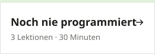
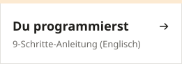
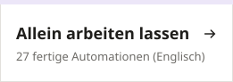
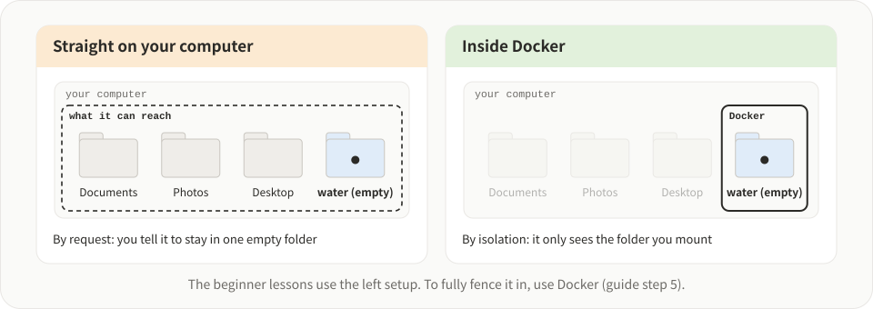

<div align="center">

# OpenHands für Einsteiger

[English](./README.en.md) · [中文](./README.md) · [日本語](./README.ja.md) · [한국어](./README.ko.md) · [Español](./README.es.md) · [Português](./README.pt.md) · [Français](./README.fr.md) · **Deutsch** · [Русский](./README.ru.md) · [العربية](./README.ar.md)

### Du willst eine KI, die die Arbeit selbst erledigt, aber die offizielle Doku hat dich abgehängt?

[OpenHands](https://github.com/OpenHands/OpenHands) ist ein Open-Source-KI-Agent fürs Programmieren. Du gibst ihm eine Aufgabe, und er führt die Befehle selbst aus, ändert die Dateien und öffnet den PR. Er kann sogar nach Zeitplan von allein loslegen.<br>Diese Anleitung erklärt ihn in einfachen Worten, damit du mitkommst, auch wenn du nicht programmierst.

<a href="https://openhands.xiaoxiaodong.ai/de/start/1-why/"><picture><source media="(prefers-color-scheme: dark)" srcset="assets/doors/de-1-dark.svg"></picture></a> <a href="https://openhands.xiaoxiaodong.ai/en/guide/0-what/"><picture><source media="(prefers-color-scheme: dark)" srcset="assets/doors/de-2-dark.svg"></picture></a> <a href="https://openhands.xiaoxiaodong.ai/en/automations/"><picture><source media="(prefers-color-scheme: dark)" srcset="assets/doors/de-3-dark.svg"></picture></a>

<sub>Kostenlos · Open Source · 10 Sprachen · Online lesen: <a href="https://openhands.xiaoxiaodong.ai/de/">openhands.xiaoxiaodong.ai/de</a></sub>


</div>

<p align="center">
  
</p>

<p align="center">
  <a href="#-hängst-du-hier-fest">Festgefahren?</a> ·
  <a href="#-so-hilft-dir-diese-anleitung">Highlights</a> ·
  <a href="#-so-funktioniert-es">So funktioniert es</a> ·
  <a href="#-in-drei-schritten-startklar">Drei Schritte</a> ·
  <a href="#-allein-arbeiten-lassen">Automationen</a> ·
  <a href="#-in-echten-projekten">Echte Projekte</a> ·
  <a href="#-sicherheit-zuerst">Sicherheit</a> ·
  <a href="#-lokal-starten">Lokal starten</a> ·
  <a href="https://openhands.xiaoxiaodong.ai/de/">Online lesen</a>
</p>

## 😵 Hängst du hier fest?

- Du öffnest die offizielle Doku und siehst npm, Docker und uv, bevor du überhaupt weißt, was du installieren sollst.
- Agent Canvas, Agent Server, Backends, ACP, Cloud, SDK: so viele Namen, und keine Ahnung, welcher davon für dich ist.
- Du hast gehört, dass er selbst Dateien ändert und Befehle ausführt, und hast Angst, dass er dir den Rest des Computers durcheinanderbringt.
- Du weißt nicht, was es kostet, oder ob du dich zuerst bei einem Haufen KI-Firmen anmelden musst.

Das liegt nicht an dir. Die offizielle Doku ist für Entwickler geschrieben und setzt voraus, dass du die Begriffe schon kennst. Diese Anleitung bringt dich erst zum Benutzen und erklärt jedes Wort dann, wenn es auftaucht.

## ✨ So hilft dir diese Anleitung

- **In einer halben Stunde von null zum Ergebnis:** drei Einsteigerlektionen, ein einziger Weg. Die Desktop-App ohne Terminal, ein Modell und deine erste kleine Webseite in einem leeren Ordner.
- **Jeder Schritt sagt, was du sehen solltest:** Siehst du es, geht es weiter. Wenn nicht, enden beide Praxislektionen mit „Wenn etwas nicht stimmt“.
- **Klartext beim Geld:** OpenHands selbst ist kostenlos. Hast du schon einen Schlüssel von Anthropic, OpenAI oder Google, oder bist du bei einem Abo von Claude Code oder Codex angemeldet, nimm das und zahl nichts extra. Nur wenn du beides nicht hast, lädst du 10 $ bei OpenHands Cloud auf, und ein kostenloses Modell rührt das Guthaben nicht an.
- **Sicherheit von Anfang an:** Beim ersten Mal arbeitet er nur in einem neuen, leeren Ordner. Für echte Abschottung gibt es eine Docker-Einrichtung.
- **Sätze zum Kopieren:** Jede Aufgabe hat drei Teile: **Was ich will · So sieht „fertig“ aus · Was du mir am Ende zeigst**. Jede Kurzanleitung hat Prompts, die du unverändert einfügen kannst.
- **Fertige Automationen, jede in einem einfachen Satz:** alle 27 offiziellen, jeweils mit dem, was sie für dich tut, was du vorher verbinden musst und wie du sie einschaltest.
- **Mit der Maus drüberfahren für eine Erklärung:** Gepunktet unterstrichene Wörter zeigen eine Erklärung in einer Zeile; ein Klick führt ins Wiki.
- **10 Sprachen:** Startseite und Einsteigerkurs gibt es in 10 Sprachen; vollständige Anleitung, Kurzanleitungen, Wiki und häufige Fragen auf Englisch und Chinesisch.
- **Gegen ein Release geprüft:** Befehle und Button-Namen sind mit dem README von OpenHands v1.40.0 und der offiziellen Doku abgeglichen.

## 🧭 So funktioniert es

<p align="center">
  
</p>

Du übergibst eine Aufgabe in **Agent Canvas**, der Steuerzentrale in deinem Browser oder in der Desktop-App. Der **Agent Server**, das Backend, das die Arbeit erledigt, übernimmt sie. Er kann auf deinem Computer laufen, in Docker, auf einer VM oder in OpenHands Cloud. Der Agent denkt mit dem Modell, das du verbunden hast; das kann der eingebaute OpenHands-Agent sein oder Claude Code, Codex oder Gemini CLI. Dann liest und schreibt er Dateien, führt Befehle aus und öffnet PRs im **Arbeitsbereich**. Mehr dazu in [Schritt 0 der vollständigen Anleitung](https://openhands.xiaoxiaodong.ai/en/guide/0-what/) (auf Englisch).

## ⚡ In drei Schritten startklar

**1. Die Desktop-App installieren.** Lade beim [neuesten OpenHands-Release](https://github.com/OpenHands/OpenHands/releases/latest) unter **Assets** die Datei für dein System herunter (Mac, Windows oder Linux). Die Desktop-App bringt alles mit, was sie braucht, also kein Terminal. Wenn du programmierst, geht auch npm:

```bash
npm install -g @openhands/agent-canvas
agent-canvas
```

**2. Ein Modell verbinden.** Das hängt davon ab, was du schon hast:

| Du hast | So verbindest du es | Kostet es extra? |
|:---|:---|:---|
| Einen API-Schlüssel von Anthropic, OpenAI, Google oder einem anderen Anbieter | Beim Einrichten des Modells deinen Anbieter wählen und den Schlüssel einfügen | Nein, abgerechnet zu den Preisen dieses Anbieters |
| Ein Abo von Claude Code, Codex oder Gemini CLI, bei dem du angemeldet bist | Über ACP verbinden, siehe [Schritt 4](https://openhands.xiaoxiaodong.ai/en/guide/4-agents/) (auf Englisch) | Nein, es nutzt das Abo, das du ohnehin bezahlst |
| Nichts davon | Einen Schlüssel bei OpenHands Cloud holen, siehe [Lektion 2](https://openhands.xiaoxiaodong.ai/de/start/2-install/) | Zuerst 10 $ aufladen; Modelle mit `Free` rühren das nicht an |

**3. Gib ihm eine Aufgabe in einem leeren Ordner.** Leg einen neuen, leeren Ordner an, öffne ihn in Agent Canvas und schick zum Beispiel das hier:

```text
Was ich will: eine kleine Webseite, die zählt, wie viele Gläser Wasser ich jeden Tag trinke. Das ist ein leerer Ordner. Leg alle Dateien hier drin an und fass nichts außerhalb davon an.
So sieht „fertig“ aus: Ich öffne die Seite und klicke auf „Ein Glas getrunken“, und die Zahl für heute steigt um eins; ich schließe die Seite, öffne sie wieder, und die Zahl ist noch da; die Seite zeigt, wie viele Gläser ich an jedem der letzten 7 Tage getrunken habe.
Zeig mir am Ende: was du geprüft hast und was du bei jeder Prüfung gesehen hast. Sag mir dann, welche Datei ich doppelklicken muss, um die Seite zu öffnen.
```

> [!TIP]
> Nimm für alles, worum du ihn bittest, dieselben drei Teile: **Was ich will · So sieht „fertig“ aus · Was du mir am Ende zeigst**. Wenn er sagt, er sei fertig, öffne das Ergebnis und prüf es selbst. Mehr dazu in [Lektion 3](https://openhands.xiaoxiaodong.ai/de/start/3-first-use/).

## 🤖 Allein arbeiten lassen

<p align="center">
  
</p>

OpenHands kann von selbst eine Unterhaltung starten, nach Zeitplan oder wenn etwas passiert. Das sind **Automationen**. Es gibt 27 offizielle fertige Automationen; such dir eine aus und schalte sie ein. Ein paar Beispiele (Seiten auf Englisch):

| Fertige Automation | Wann sie läuft | Was sie für dich tut |
|:---|:---|:---|
| [GitHub-Code-Review](https://openhands.xiaoxiaodong.ai/en/automations/github-pr-reviewer/) | Zeitplan / Ereignis | Findet Pull Requests, die auf ein Review warten, und lässt sie von einem Agenten auf GitHub prüfen |
| [Vom Linear-Issue zum GitHub-PR](https://openhands.xiaoxiaodong.ai/en/automations/linear-issue-to-github-pr/) | Zeitplan / Ereignis | Markier ein Linear-Issue als bereit, und der Agent setzt es um und öffnet dann einen GitHub-PR |
| [Slack-Standup-Zusammenfassung](https://openhands.xiaoxiaodong.ai/en/automations/slack-standup-digest/) | Zeitplan | Macht an jedem Werktag morgens aus den Slack-Nachrichten von gestern eine Standup-Notiz |
| [Täglicher Nachrichtenüberblick](https://openhands.xiaoxiaodong.ai/en/automations/news-digest/) | Zeitplan | Liest jeden Tag deine Newsfeeds, sucht heraus, was für dich zählt, und schreibt einen kurzen Überblick |
| [AGENTS.md Maintainer](https://openhands.xiaoxiaodong.ai/en/automations/github-agents-md-maintainer/) | Zeitplan | Hält AGENTS.md aktuell und öffnet einen PR, wenn sich etwas ändert |

Alle 27 stehen unter [Fertige Automationen](https://openhands.xiaoxiaodong.ai/en/automations/) (auf Englisch). Wie du eigene schreibst, steht in [Schritt 6 der vollständigen Anleitung](https://openhands.xiaoxiaodong.ai/en/guide/6-automations/) (auf Englisch).

## 🛠 In echten Projekten

Die Kurzanleitungen sind auf Englisch.

| Die Aufgabe vor dir | Lies das | Das Wichtigste |
|:---|:---|:---|
| Eine unbekannte Codebasis | [Erst verstehen](https://openhands.xiaoxiaodong.ai/en/howto/new-codebase/) | Lass ihn lesen, ohne etwas zu ändern, das Projekt erklären und das dann in AGENTS.md festhalten |
| Ein GitHub-Issue | [Einen PR daraus machen](https://openhands.xiaoxiaodong.ai/en/howto/issue-to-pr/) | Erst eins in einer Unterhaltung durchspielen; wenn das klappt, die Automation einschalten und nur noch ein Label setzen |
| PRs reviewen | [Ihn reviewen lassen](https://openhands.xiaoxiaodong.ai/en/howto/code-review/) | `/codereview` in einem PR eintippen; für jeden PR die Automation einschalten |
| Unsicher bei deinen Änderungen | [Wie ein Nutzer ausprobieren](https://openhands.xiaoxiaodong.ai/en/howto/qa-changes/) | `/qa-changes` eintippen; er startet die Software und meldet sich mit Belegen zurück |
| Sorge, dass er zu viel anfasst | [In Docker laufen lassen](https://openhands.xiaoxiaodong.ai/en/howto/docker-sandbox/) | In Docker starten, dann sieht er nur den einen Ordner, den du einbindest |
| Code darf deinen Rechner nicht verlassen | [Ein lokales Modell nutzen](https://openhands.xiaoxiaodong.ai/en/howto/local-llm/) | Ein Modell mit LM Studio bereitstellen und seine Adresse in den erweiterten Einstellungen eintragen |
| Nicht am Schreibtisch | [Vom Handy aus zuschauen](https://openhands.xiaoxiaodong.ai/en/howto/phone/) | Handy und Computer ins selbe Tailscale-Netz bringen und die Adresse des Computers öffnen |
| Sorge wegen der Rechnung | [Kosten niedrig halten](https://openhands.xiaoxiaodong.ai/en/howto/cost/) | Günstige Modelle für kleine Sachen; Automationen nicht zu oft einplanen |

Dazu [Prompts zum Kopieren](https://openhands.xiaoxiaodong.ai/en/howto/recipes/), [wie du ihn so einweist, dass er auf Kurs bleibt](https://openhands.xiaoxiaodong.ai/en/howto/good-instructions/), [startet nicht oder verbindet sich nicht?](https://openhands.xiaoxiaodong.ai/en/howto/troubleshoot/) und mehr: 20 insgesamt.

## 🔒 Sicherheit zuerst

<p align="center">
  
</p>

> [!WARNING]
> Wenn OpenHands direkt auf deinem Computer läuft, hat der Agent die Rechte deines Benutzerkontos: Er kann deine Dateien lesen und schreiben und Befehle ausführen, und standardmäßig fragt er nicht vor jedem Schritt. Der Einsteigerkurs lässt ihn nur in einem neuen, leeren Ordner arbeiten. Für echte Abschottung lass ihn in Docker laufen ([Schritt 5 der vollständigen Anleitung](https://openhands.xiaoxiaodong.ai/en/guide/5-backends/), auf Englisch).

## 📚 Was es auf der Website gibt

- **[Einsteigerkurs](https://openhands.xiaoxiaodong.ai/de/start/1-why/)**: 3 Lektionen, 30 Minuten, ohne Programmieren · Was er für dich tut → Installieren → Zum ersten Mal benutzen
- **[Vollständige Anleitung](https://openhands.xiaoxiaodong.ai/en/guide/0-what/)** (Englisch): 9 Schritte für alle, die programmieren · was es ist → Installation → Modelle → erste Unterhaltung → andere Agenten → Backends → Automationen → Skills, Plugins, MCP → selbst hosten und das SDK
- **[Fertige Automationen](https://openhands.xiaoxiaodong.ai/en/automations/)** (Englisch): alle 27, filterbar nach Name, Gruppe oder Auslöser
- **[Kurzanleitungen](https://openhands.xiaoxiaodong.ai/en/howto/)** (Englisch): 20 Seiten, je eine Aufgabe
- **[Wiki](https://openhands.xiaoxiaodong.ai/en/wiki/)** (Englisch): 32 Begriffe · ein Satz → ein Vergleich → in OpenHands → häufige Missverständnisse
- **[Häufige Fragen](https://openhands.xiaoxiaodong.ai/en/faq/)** (Englisch): Kostet es Geld? Brauche ich einen API-Schlüssel? Er führt Befehle aus, ohne zu fragen; ist das sicher?
- **Sprachen**: Startseite und Einsteigerkurs in 10 Sprachen; alles andere auf Englisch und Chinesisch

Drück oben rechts <kbd>⌘</kbd> <kbd>K</kbd>, um die ganze Website zu durchsuchen. Hell, dunkel und auf dem Handy: alles funktioniert.

## 💻 Lokal starten

```bash
npm install
npm run dev          # http://localhost:4421
npm run build        # Ausgabe nach dist/, prüft interne Links
npm run check:i18n   # sind die anderen 8 Sprachen vollständig?
npm run assets       # erzeugt die README-Bilder neu
npm run release      # bauen und auf Cloudflare veröffentlichen
```

```text
src/data/nav.js          Aufbau der Website: Einsteigerkurs, vollständige Anleitung, Liste der Kurzanleitungen (einzige Quelle)
src/data/glossary.js     Begriffe: Tooltip-Text und ihre Wiki-Einträge
src/data/automations.js  Daten der fertigen Automationen
src/i18n/                Oberflächentexte für die anderen 8 Sprachen (base.js ist die englische Basis)
src/pages/start/         die 3 Lektionen des Einsteigerkurses (MDX)
src/pages/guide/         die vollständige Anleitung (MDX)
src/pages/howto/         Kurzanleitungen (MDX)
public/xxd/              Xiaoxiaodong UI Kit (mitgeliefert, ohne CDN)
tools/build_assets.py    README-Illustrationen, Türen und Vorschaubilder zum Teilen
```

Wie du Inhalte bearbeitest, Seiten hinzufügst und welche Schreibregeln gelten, steht in [docs/MAINTAINING.md](docs/MAINTAINING.md) (auf Chinesisch).

## 🙌 Danksagung

- [OpenHands](https://github.com/OpenHands/OpenHands) stammt von den OpenHands-Mitwirkenden (MIT-Lizenz). Das hier ist eine inoffizielle Einsteiger-Anleitung; bei Befehlen und Verhalten gilt, was im [offiziellen Repo](https://github.com/OpenHands/OpenHands) und in der [Doku](https://docs.openhands.dev) steht.
- Das Gerüst der Website stammt von [xxd-pstack](https://github.com/nevertoday/xxd-pstack); die Oberfläche nutzt das [Xiaoxiaodong UI Kit](https://ui.xiaoxiaodong.ai).

Ist etwas unklar, oder hat etwas nicht so funktioniert wie beschrieben? [Eröffne ein Issue](https://github.com/nevertoday/xxd-openhands/issues).

## 📄 Lizenz

Der Text der Anleitung und der Code der Website stehen unter [MIT](LICENSE). Der Build des Xiaoxiaodong UI Kit in `public/xxd/` nicht; er hat seine eigene [LICENSE](public/xxd/LICENSE) (kostenlos für nicht-kommerzielle Nutzung, für kommerzielle Nutzung ist eine Lizenz nötig).

Copyright (c) 2026 [Xiaoxiaodong](https://x.com/xiaoxiaodong)
