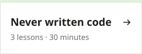
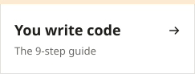
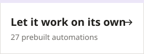

<div align="center">

# OpenHands for beginners

**English** · [中文](./README.md) · [日本語](./README.ja.md) · [한국어](./README.ko.md) · [Español](./README.es.md) · [Português](./README.pt.md) · [Français](./README.fr.md) · [Deutsch](./README.de.md) · [Русский](./README.ru.md) · [العربية](./README.ar.md)

### Someone told you to try OpenHands, and the official docs lost you?

[OpenHands](https://github.com/OpenHands/OpenHands) is an open-source AI coding agent. You hand it a task, and it runs the commands, edits the files and opens the PR itself. It can even start work on a schedule.<br>This guide explains it in plain words, so you can follow along even if you don't code.

<a href="https://openhands.xiaoxiaodong.ai/en/start/1-why/"><picture><source media="(prefers-color-scheme: dark)" srcset="assets/doors/en-1-dark.svg"></picture></a> <a href="https://openhands.xiaoxiaodong.ai/en/guide/0-what/"><picture><source media="(prefers-color-scheme: dark)" srcset="assets/doors/en-2-dark.svg"></picture></a> <a href="https://openhands.xiaoxiaodong.ai/en/automations/"><picture><source media="(prefers-color-scheme: dark)" srcset="assets/doors/en-3-dark.svg"></picture></a>

<sub>Free · Open source · 10 languages · Read online: <a href="https://openhands.xiaoxiaodong.ai/en/">openhands.xiaoxiaodong.ai/en</a></sub>


</div>

<p align="center">
  
</p>

<p align="center">
  <a href="#-stuck-here">Stuck?</a> ·
  <a href="#-how-this-guide-helps">Highlights</a> ·
  <a href="#-how-it-works">How it works</a> ·
  <a href="#-up-and-running-in-three-steps">Three steps</a> ·
  <a href="#-let-it-work-on-its-own">Automations</a> ·
  <a href="#-in-real-projects">Real projects</a> ·
  <a href="#-safety-first">Safety</a> ·
  <a href="#-run-it-locally">Run locally</a> ·
  <a href="https://openhands.xiaoxiaodong.ai/en/">Read online</a>
</p>

## 😵 Stuck here?

- You open the official docs and see npm, Docker and uv before you know which one to install.
- Agent Canvas, Agent Server, backends, ACP, Cloud, SDK: so many names, and no clue which one is for you.
- You've heard it edits files and runs commands on its own, and you worry it will mess up the rest of your computer.
- You don't know what it costs, or whether you need accounts with a pile of AI companies first.

That's not on you. The official docs are written for engineers and assume you know the words. This guide gets you using it first, then explains each word as it comes up.

## ✨ How this guide helps

- **From zero to working in half an hour:** three beginner lessons, one path: the desktop app with no terminal, one model, and your first small web page in an empty folder.
- **Every step says what you should see:** if you see it, move on. If not, both hands-on lessons end with "If something's off."
- **Straight talk about money:** OpenHands itself is free. If you already have an Anthropic, OpenAI or Google key, or you're signed in to a Claude Code or Codex subscription, use that and pay nothing extra. Only if you have neither do you add $10 on OpenHands Cloud, and there's a free model that doesn't use it.
- **Safety up front:** the first time, it works only inside a new, empty folder. For real isolation, there's a Docker setup.
- **Words you can copy:** every task takes three parts: **What I want · What done looks like · What to show me when it's done**. Every how-to has prompts you can paste as they are.
- **Prebuilt automations, one plain sentence each:** all 27 official ones, each with what it does for you, what to connect first, and how to turn it on.
- **Hover for a definition:** words with a dotted underline show a one-line explanation; click through to the Wiki.
- **10 languages:** the home page and beginner track are in 10 languages; the full guide, how-tos, Wiki and FAQ are in English and Chinese.
- **Checked against a release:** commands and button names are checked against the OpenHands v1.40.0 README and the official docs.

## 🧭 How it works

<p align="center">
  
</p>

You hand a task over in **Agent Canvas**, the control center in your browser or the desktop app. The **Agent Server**, the backend that does the work, takes it. It can run on your computer, in Docker, on a VM or on OpenHands Cloud. The agent thinks with the model you connected; it can be the built-in OpenHands agent, or Claude Code, Codex or Gemini CLI. Then it reads and writes files, runs commands and opens PRs in the **workspace**. More in [full guide step 0](https://openhands.xiaoxiaodong.ai/en/guide/0-what/).

## ⚡ Up and running in three steps

**1. Install the desktop app.** On the [latest OpenHands release](https://github.com/OpenHands/OpenHands/releases/latest), download the file for your system under **Assets** (Mac, Windows and Linux). The desktop app brings what it needs, so there's no terminal. If you code, npm works too:

```bash
npm install -g @openhands/agent-canvas
agent-canvas
```

**2. Connect a model.** It depends on what you already have:

| You have | How to connect it | Extra cost? |
|:---|:---|:---|
| An API key from Anthropic, OpenAI, Google or another provider | Pick your provider when you set up the model, paste the key | No, billed at that provider's prices |
| A Claude Code, Codex or Gemini CLI subscription you're signed in to | Connect it through ACP, see [step 4](https://openhands.xiaoxiaodong.ai/en/guide/4-agents/) | No, it uses the subscription you already pay for |
| Neither | Get a key on OpenHands Cloud, see [lesson 2](https://openhands.xiaoxiaodong.ai/en/start/2-install/) | Add $10 first; models marked `Free` don't use it |

**3. Hand it one task in an empty folder.** Make a new, empty folder, open it in Agent Canvas, and send something like this:

```text
What I want: a small web page that tracks how many glasses of water I drink each day. This is an empty folder. Put every file in it, and don't touch anything outside it.
What done looks like: I open the page and click "I drank a glass," and today's count goes up by one; I close it and open it again and the number is still there; the page shows how many glasses I drank on each of the last 7 days.
When you're done, show me: what you checked and what you saw for each check. Then tell me which file to double-click to open the page.
```

> [!TIP]
> Use the same three parts for anything you ask: **What I want · What done looks like · What to show me when it's done**. When it says it's done, open the result and check it yourself. More in [lesson 3](https://openhands.xiaoxiaodong.ai/en/start/3-first-use/).

## 🤖 Let it work on its own

OpenHands can start a conversation by itself on a schedule or when something happens. These are **automations**. There are 27 official prebuilt ones; pick one and turn it on. A few examples:

| Prebuilt automation | When it runs | What it does for you |
|:---|:---|:---|
| [GitHub code review](https://openhands.xiaoxiaodong.ai/en/automations/github-pr-reviewer/) | Schedule / event | Finds pull requests waiting for review and has an agent review them on GitHub |
| [Linear issue to GitHub PR](https://openhands.xiaoxiaodong.ai/en/automations/linear-issue-to-github-pr/) | Schedule / event | Mark a Linear issue ready and the agent implements it, then opens a GitHub PR |
| [Slack standup digest](https://openhands.xiaoxiaodong.ai/en/automations/slack-standup-digest/) | Schedule | Every weekday morning, turns yesterday's Slack messages into a standup note |
| [Daily news digest](https://openhands.xiaoxiaodong.ai/en/automations/news-digest/) | Schedule | Reads your news feeds every day, picks what matters to you and writes a short digest |
| [AGENTS.md Maintainer](https://openhands.xiaoxiaodong.ai/en/automations/github-agents-md-maintainer/) | Schedule | Keeps AGENTS.md up to date and opens a PR when it changes |

All 27 are in [Prebuilt automations](https://openhands.xiaoxiaodong.ai/en/automations/). To write your own, see [full guide step 6](https://openhands.xiaoxiaodong.ai/en/guide/6-automations/).

## 🛠 In real projects

| The job in hand | Read this | The gist |
|:---|:---|:---|
| An unfamiliar codebase | [Understand it first](https://openhands.xiaoxiaodong.ai/en/howto/new-codebase/) | Have it read without changing anything, explain the project, then save that in AGENTS.md |
| A GitHub issue | [Turn it into a PR](https://openhands.xiaoxiaodong.ai/en/howto/issue-to-pr/) | Do one in a conversation first; once that works, turn on the automation and just add a label |
| Reviewing PRs | [Have it review](https://openhands.xiaoxiaodong.ai/en/howto/code-review/) | Type `/codereview` on a PR; to review every PR, turn on the automation |
| Unsure about your changes | [Try them like a user](https://openhands.xiaoxiaodong.ai/en/howto/qa-changes/) | Type `/qa-changes`; it runs the software and reports back with evidence |
| Worried it touches too much | [Run it inside Docker](https://openhands.xiaoxiaodong.ai/en/howto/docker-sandbox/) | Start it in Docker, and it only sees the one folder you mount |
| Code must stay on your machine | [Use a local model](https://openhands.xiaoxiaodong.ai/en/howto/local-llm/) | Serve a model with LM Studio, then enter its address in the Advanced settings |
| Away from your desk | [Watch from your phone](https://openhands.xiaoxiaodong.ai/en/howto/phone/) | Put phone and computer on one Tailscale network and open the computer's address |
| Worried about the bill | [Keep costs down](https://openhands.xiaoxiaodong.ai/en/howto/cost/) | Cheap models for small things; don't schedule automations too often |

Plus [copy-paste prompts](https://openhands.xiaoxiaodong.ai/en/howto/recipes/), [how to brief it so it stays on track](https://openhands.xiaoxiaodong.ai/en/howto/good-instructions/), [won't open or connect?](https://openhands.xiaoxiaodong.ai/en/howto/troubleshoot/) and more: 19 in all.

## 🔒 Safety first

> [!WARNING]
> When OpenHands runs directly on your computer, the agent has your account's permissions: it can read and write your files and run commands, and by default it doesn't ask before each step. The beginner track has it work only inside a new, empty folder. For real isolation, run it in Docker ([full guide step 5](https://openhands.xiaoxiaodong.ai/en/guide/5-backends/)).

## 📚 What's on the site

- **[Beginner track](https://openhands.xiaoxiaodong.ai/en/start/1-why/)**: 3 lessons, 30 minutes, no coding needed · What it does for you → Install it → Use it for the first time
- **[Full guide](https://openhands.xiaoxiaodong.ai/en/guide/0-what/)**: 9 steps for people who code · what it is → install → models → first conversation → other agents → backends → automations → skills, plugins, MCP → self-hosting and the SDK
- **[Prebuilt automations](https://openhands.xiaoxiaodong.ai/en/automations/)**: all 27, filter by name, group or trigger
- **[How-to](https://openhands.xiaoxiaodong.ai/en/howto/)**: 19 pages, one job each
- **[Wiki](https://openhands.xiaoxiaodong.ai/en/wiki/)**: 24 terms · one sentence → an analogy → in OpenHands → common misconceptions
- **[FAQ](https://openhands.xiaoxiaodong.ai/en/faq/)**: Does it cost money? Do I need an API key? It runs commands without asking; is that safe?
- **Languages**: the home page and beginner track in 10 languages; everything else in English and Chinese

Press <kbd>⌘</kbd> <kbd>K</kbd> at the top right to search the whole site. Light, dark and phone all work.

## 💻 Run it locally

```bash
npm install
npm run dev          # http://localhost:4421
npm run build        # outputs to dist/ and checks internal links
npm run check:i18n   # are the other 8 languages complete?
npm run assets       # regenerate the README images
npm run release      # build and deploy to Cloudflare
```

```text
src/data/nav.js          site structure: beginner track, full guide, how-to list (single source)
src/data/glossary.js     terms: hover text and their Wiki entries
src/data/automations.js  prebuilt automations data
src/i18n/                UI text for the other 8 languages (base.js is the English base)
src/pages/start/         the 3 beginner lessons (MDX)
src/pages/guide/         the full guide (MDX)
src/pages/howto/         how-tos (MDX)
public/xxd/              Xiaoxiaodong UI Kit (bundled, no CDN)
tools/build_assets.py    README illustrations, doors and share images
```

Editing content, adding pages and the writing rules are in [docs/MAINTAINING.md](docs/MAINTAINING.md) (in Chinese).

## 🙌 Credits

- [OpenHands](https://github.com/OpenHands/OpenHands) is made by the OpenHands contributors (MIT license). This is an unofficial beginner's guide; the [official repo](https://github.com/OpenHands/OpenHands) and [docs](https://docs.openhands.dev) are the source of truth for commands and behavior.
- The site skeleton comes from [xxd-pstack](https://github.com/nevertoday/xxd-pstack); the interface uses the [Xiaoxiaodong UI Kit](https://ui.xiaoxiaodong.ai).

Found something unclear, or something that didn't work as written? [Open an issue](https://github.com/nevertoday/xxd-openhands/issues).

## 📄 License

The guide's text and site code are [MIT](LICENSE). The Xiaoxiaodong UI Kit build in `public/xxd/` is not; it has its own [LICENSE](public/xxd/LICENSE) (free for noncommercial use, commercial use needs a license).

Copyright (c) 2026 [Xiaoxiaodong](https://x.com/xiaoxiaodong01)
