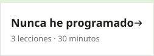
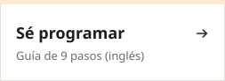
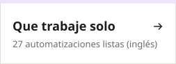

<div align="center">

# OpenHands para principiantes

[English](./README.en.md) · [中文](./README.md) · [日本語](./README.ja.md) · [한국어](./README.ko.md) · **Español** · [Português](./README.pt.md) · [Français](./README.fr.md) · [Deutsch](./README.de.md) · [Русский](./README.ru.md) · [العربية](./README.ar.md)

### ¿Te recomendaron probar OpenHands y la documentación oficial te dejó perdido?

[OpenHands](https://github.com/OpenHands/OpenHands) es un agente de programación con IA, de código abierto. Le das una tarea y él mismo ejecuta los comandos, edita los archivos y abre el PR. Incluso puede ponerse a trabajar a una hora programada.<br>Esta guía lo explica con palabras sencillas, para que puedas seguirla aunque no sepas programar.

<a href="https://openhands.xiaoxiaodong.ai/es/start/1-why/"><picture><source media="(prefers-color-scheme: dark)" srcset="assets/doors/es-1-dark.svg"></picture></a> <a href="https://openhands.xiaoxiaodong.ai/en/guide/0-what/"><picture><source media="(prefers-color-scheme: dark)" srcset="assets/doors/es-2-dark.svg"></picture></a> <a href="https://openhands.xiaoxiaodong.ai/en/automations/"><picture><source media="(prefers-color-scheme: dark)" srcset="assets/doors/es-3-dark.svg"></picture></a>

<sub>Gratis · código abierto · 10 idiomas · Léela en línea: <a href="https://openhands.xiaoxiaodong.ai/es/">openhands.xiaoxiaodong.ai/es</a></sub>


</div>

<p align="center">
  
</p>

<p align="center">
  <a href="#-te-atascas-aquí">¿Atascado?</a> ·
  <a href="#-cómo-te-ayuda-esta-guía">Lo que aporta</a> ·
  <a href="#-cómo-funciona">Cómo funciona</a> ·
  <a href="#-en-marcha-en-tres-pasos">Tres pasos</a> ·
  <a href="#-déjalo-trabajar-solo">Automatizaciones</a> ·
  <a href="#-en-proyectos-reales">Proyectos reales</a> ·
  <a href="#-primero-la-seguridad">Seguridad</a> ·
  <a href="#-ejecutarlo-en-local">En local</a> ·
  <a href="https://openhands.xiaoxiaodong.ai/es/">Leer en línea</a>
</p>

## 😵 ¿Te atascas aquí?

- Abres la documentación oficial y ves npm, Docker y uv antes de saber cuál tienes que instalar.
- Agent Canvas, Agent Server, backends, ACP, Cloud, SDK: tantos nombres y ni idea de cuál es para ti.
- Has oído que edita archivos y ejecuta comandos por su cuenta, y te preocupa que desordene el resto de tu computadora.
- No sabes cuánto cuesta, ni si antes tienes que abrir cuentas en un montón de empresas de IA.

No es culpa tuya. La documentación oficial está escrita para ingenieros y da por hecho que conoces las palabras. Esta guía primero te pone a usarlo y luego te explica cada palabra cuando aparece.

## ✨ Cómo te ayuda esta guía

- **De cero a usarlo en media hora:** tres lecciones para principiantes, un solo camino: la aplicación de escritorio sin terminal, un modelo y tu primera página web pequeña en una carpeta vacía.
- **Cada paso te dice qué deberías ver:** si lo ves, sigues. Si no, las dos lecciones prácticas terminan con «Si algo no sale bien».
- **Claridad con el dinero:** OpenHands en sí es gratis. Si ya tienes una clave de Anthropic, OpenAI o Google, o una suscripción a Claude Code o Codex con la que ya iniciaste sesión, úsala y no pagas nada extra. Solo si no tienes ninguna de las dos recargas 10 $ en OpenHands Cloud, y hay un modelo gratis que no gasta ese saldo.
- **La seguridad, desde el principio:** la primera vez, trabaja solo dentro de una carpeta nueva y vacía. Para aislarlo de verdad, hay una configuración con Docker.
- **Palabras que puedes copiar:** cada tarea lleva tres partes: **Lo que quiero · Cómo se ve terminado · Qué me muestras al terminar**. Cada how-to trae prompts que puedes pegar tal cual.
- **Automatizaciones listas para usar, cada una en una frase sencilla:** las 27 oficiales, cada una con qué hace por ti, qué conectar antes y cómo activarla.
- **Pasa el ratón para ver la definición:** las palabras con subrayado punteado muestran una explicación de una línea; haz clic para ir a la Wiki.
- **10 idiomas:** la página de inicio y las lecciones para principiantes están en 10 idiomas; la guía completa, los how-to, la Wiki y las preguntas frecuentes están en inglés y en chino.
- **Revisada con una versión concreta:** los comandos y los nombres de los botones se revisaron con el README de OpenHands v1.40.0 y la documentación oficial.

## 🧭 Cómo funciona

<p align="center">
  
</p>

Entregas una tarea en **Agent Canvas**, el centro de control en tu navegador o en la aplicación de escritorio. La recibe el **Agent Server**, el backend que hace el trabajo. Puede correr en tu computadora, en Docker, en una VM o en OpenHands Cloud. El agente piensa con el modelo que conectaste; puede ser el agente OpenHands integrado, o Claude Code, Codex o Gemini CLI. Después lee y escribe archivos, ejecuta comandos y abre PR en el **espacio de trabajo**. Más en el [paso 0 de la guía completa](https://openhands.xiaoxiaodong.ai/en/guide/0-what/) (en inglés).

## ⚡ En marcha en tres pasos

**1. Instala la aplicación de escritorio.** En la [última versión publicada de OpenHands](https://github.com/OpenHands/OpenHands/releases/latest), descarga el archivo para tu sistema en **Assets** (Mac, Windows y Linux). La aplicación de escritorio trae todo lo que necesita, así que no usas la terminal. Si sabes programar, también funciona con npm:

```bash
npm install -g @openhands/agent-canvas
agent-canvas
```

**2. Conecta un modelo.** Depende de lo que ya tengas:

| Tienes | Cómo conectarlo | ¿Cuesta algo extra? |
|:---|:---|:---|
| Una API key de Anthropic, OpenAI, Google u otro proveedor | Elige tu proveedor al configurar el modelo y pega la clave | No, se cobra a los precios de ese proveedor |
| Una suscripción a Claude Code, Codex o Gemini CLI con la que ya iniciaste sesión | Conéctala a través de ACP; mira el [paso 4](https://openhands.xiaoxiaodong.ai/en/guide/4-agents/) (en inglés) | No, usa la suscripción que ya pagas |
| Ninguna de las dos | Consigue una clave en OpenHands Cloud; mira la [lección 2](https://openhands.xiaoxiaodong.ai/es/start/2-install/) | Primero recargas 10 $; los modelos marcados como `Free` no lo gastan |

**3. Dale una tarea en una carpeta vacía.** Crea una carpeta nueva y vacía, ábrela en Agent Canvas y envía algo así:

```text
Lo que quiero: una página web pequeña que registre cuántos vasos de agua bebo cada día. Esta carpeta está vacía. Pon todos los archivos dentro de ella y no toques nada fuera de ella.
Cómo se ve terminado: abro la página y hago clic en «Bebí un vaso», y el número de hoy sube en uno; la cierro y la vuelvo a abrir, y el número sigue ahí; la página muestra cuántos vasos bebí cada uno de los últimos 7 días.
Al terminar, muéstrame: qué comprobaste y qué viste en cada comprobación. Luego dime en qué archivo hago doble clic para abrir la página.
```

> [!TIP]
> Usa las mismas tres partes para cualquier cosa que le pidas: **Lo que quiero · Cómo se ve terminado · Qué me muestras al terminar**. Cuando diga que terminó, abre el resultado y compruébalo tú. Más en la [lección 3](https://openhands.xiaoxiaodong.ai/es/start/3-first-use/).

## 🤖 Déjalo trabajar solo

OpenHands puede iniciar una conversación por su cuenta, a una hora programada o cuando pasa algo. Eso son las **automatizaciones**. Hay 27 oficiales listas para usar; eliges una y la activas. Algunos ejemplos (las páginas están en inglés):

| Automatización lista para usar | Cuándo se ejecuta | Qué hace por ti |
|:---|:---|:---|
| [Revisión de código en GitHub](https://openhands.xiaoxiaodong.ai/en/automations/github-pr-reviewer/) | Programada / por evento | Busca los pull requests que esperan revisión y hace que un agente los revise en GitHub |
| [De issue de Linear a PR de GitHub](https://openhands.xiaoxiaodong.ai/en/automations/linear-issue-to-github-pr/) | Programada / por evento | Marcas un issue de Linear como listo y el agente lo implementa y luego abre un PR en GitHub |
| [Resumen de standup en Slack](https://openhands.xiaoxiaodong.ai/en/automations/slack-standup-digest/) | Programada | Cada mañana de lunes a viernes, convierte los mensajes de Slack de ayer en una nota para el standup |
| [Resumen diario de noticias](https://openhands.xiaoxiaodong.ai/en/automations/news-digest/) | Programada | Lee tus fuentes de noticias cada día, elige lo que te importa y escribe un resumen corto |
| [Mantenedor de AGENTS.md](https://openhands.xiaoxiaodong.ai/en/automations/github-agents-md-maintainer/) | Programada | Mantiene AGENTS.md al día y abre un PR cuando cambia |

Las 27 están en [Automatizaciones listas para usar](https://openhands.xiaoxiaodong.ai/en/automations/) (en inglés). Para escribir las tuyas, mira el [paso 6 de la guía completa](https://openhands.xiaoxiaodong.ai/en/guide/6-automations/) (en inglés).

## 🛠 En proyectos reales

Los how-to están en inglés.

| Lo que tienes entre manos | Lee esto | La idea clave |
|:---|:---|:---|
| Un código que no conoces | [Entiéndelo primero](https://openhands.xiaoxiaodong.ai/en/howto/new-codebase/) | Que lo lea sin cambiar nada, te explique el proyecto y luego lo guarde en AGENTS.md |
| Un issue de GitHub | [Conviértelo en un PR](https://openhands.xiaoxiaodong.ai/en/howto/issue-to-pr/) | Haz uno primero en una conversación; cuando funcione, activa la automatización y solo añade una etiqueta |
| Revisar PR | [Que los revise él](https://openhands.xiaoxiaodong.ai/en/howto/code-review/) | Escribe `/codereview` en un PR; para revisar todos los PR, activa la automatización |
| Dudas sobre tus cambios | [Pruébalos como un usuario](https://openhands.xiaoxiaodong.ai/en/howto/qa-changes/) | Escribe `/qa-changes`; ejecuta el software y te informa con pruebas |
| Te preocupa que toque demasiado | [Ejecútalo dentro de Docker](https://openhands.xiaoxiaodong.ai/en/howto/docker-sandbox/) | Arráncalo en Docker y solo verá la carpeta que montes |
| El código no puede salir de tu máquina | [Usa un modelo local](https://openhands.xiaoxiaodong.ai/en/howto/local-llm/) | Sirve un modelo con LM Studio y escribe su dirección en los ajustes avanzados |
| Lejos de tu escritorio | [Síguelo desde el celular](https://openhands.xiaoxiaodong.ai/en/howto/phone/) | Pon el celular y la computadora en la misma red de Tailscale y abre la dirección de la computadora |
| Te preocupa la factura | [Gasta menos](https://openhands.xiaoxiaodong.ai/en/howto/cost/) | Modelos baratos para las cosas pequeñas; no programes las automatizaciones demasiado seguido |

Y además [prompts para copiar y pegar](https://openhands.xiaoxiaodong.ai/en/howto/recipes/), [cómo darle instrucciones para que no se desvíe](https://openhands.xiaoxiaodong.ai/en/howto/good-instructions/), [¿no abre o no conecta?](https://openhands.xiaoxiaodong.ai/en/howto/troubleshoot/) y más: 19 en total.

## 🔒 Primero, la seguridad

> [!WARNING]
> Cuando OpenHands se ejecuta directamente en tu computadora, el agente tiene los permisos de tu cuenta: puede leer y escribir tus archivos y ejecutar comandos, y por defecto no pregunta antes de cada paso. Las lecciones para principiantes lo hacen trabajar solo dentro de una carpeta nueva y vacía. Para aislarlo de verdad, ejecútalo en Docker ([paso 5 de la guía completa](https://openhands.xiaoxiaodong.ai/en/guide/5-backends/), en inglés).

## 📚 Qué hay en el sitio

- **[Para principiantes](https://openhands.xiaoxiaodong.ai/es/start/1-why/)**: 3 lecciones, 30 minutos, sin programar · Qué hace por ti → Instálalo → Úsalo por primera vez
- **[Guía completa](https://openhands.xiaoxiaodong.ai/en/guide/0-what/)** (en inglés): 9 pasos para quien programa · qué es → instalar → modelos → primera conversación → otros agentes → backends → automatizaciones → skills, plugins y MCP → alojamiento propio y el SDK
- **[Automatizaciones listas para usar](https://openhands.xiaoxiaodong.ai/en/automations/)** (en inglés): las 27, con filtro por nombre, grupo o disparador
- **[How-to](https://openhands.xiaoxiaodong.ai/en/howto/)** (en inglés): 19 páginas, una tarea cada una
- **[Wiki](https://openhands.xiaoxiaodong.ai/en/wiki/)** (en inglés): 24 términos · una frase → una analogía → en OpenHands → errores comunes
- **[Preguntas frecuentes](https://openhands.xiaoxiaodong.ai/en/faq/)** (en inglés): ¿Cuesta dinero? ¿Necesito una API key? Ejecuta comandos sin preguntar, ¿es seguro?
- **Idiomas**: la página de inicio y las lecciones para principiantes en 10 idiomas; todo lo demás en inglés y en chino

Pulsa <kbd>⌘</kbd> <kbd>K</kbd> arriba a la derecha para buscar en todo el sitio. Funciona en modo claro, en modo oscuro y en el celular.

## 💻 Ejecutarlo en local

```bash
npm install
npm run dev          # http://localhost:4421
npm run build        # genera dist/ y comprueba los enlaces internos
npm run check:i18n   # ¿están completos los otros 8 idiomas?
npm run assets       # vuelve a generar las imágenes del README
npm run release      # compila y despliega en Cloudflare
```

```text
src/data/nav.js          estructura del sitio: lecciones, guía completa, lista de how-to (fuente única)
src/data/glossary.js     términos: el texto al pasar el ratón y su entrada en la Wiki
src/data/automations.js  datos de las automatizaciones listas para usar
src/i18n/                textos de la interfaz para los otros 8 idiomas (base.js es la base en inglés)
src/pages/start/         las 3 lecciones para principiantes (MDX)
src/pages/guide/         la guía completa (MDX)
src/pages/howto/         los how-to (MDX)
public/xxd/              Xiaoxiaodong UI Kit (copia incluida, sin CDN)
tools/build_assets.py    ilustraciones del README, tarjetas de entrada e imágenes para compartir
```

Para editar contenido, añadir páginas y las normas de redacción, consulta [docs/MAINTAINING.md](docs/MAINTAINING.md) (en chino).

## 🙌 Agradecimientos

- [OpenHands](https://github.com/OpenHands/OpenHands) lo hacen los colaboradores de OpenHands (licencia MIT). Esta es una guía no oficial para principiantes; el [repositorio oficial](https://github.com/OpenHands/OpenHands) y la [documentación](https://docs.openhands.dev) son la referencia para comandos y comportamiento.
- La estructura del sitio viene de [xxd-pstack](https://github.com/nevertoday/xxd-pstack); la interfaz usa el [Xiaoxiaodong UI Kit](https://ui.xiaoxiaodong.ai).

¿Algo no está claro o no funcionó como dice aquí? [Abre un issue](https://github.com/nevertoday/xxd-openhands/issues).

## 📄 Licencia

El texto de la guía y el código del sitio están bajo [MIT](LICENSE). La compilación del Xiaoxiaodong UI Kit en `public/xxd/` no; tiene su propia [LICENSE](public/xxd/LICENSE) (gratis para uso no comercial; el uso comercial requiere licencia).

Copyright (c) 2026 [Xiaoxiaodong](https://x.com/xiaoxiaodong)
