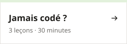
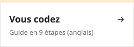
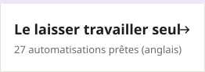
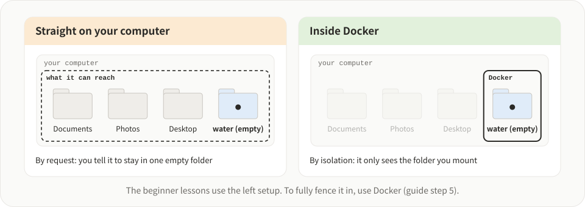

<div align="center">

# OpenHands pour débutants

[English](./README.en.md) · [中文](./README.md) · [日本語](./README.ja.md) · [한국어](./README.ko.md) · [Español](./README.es.md) · [Português](./README.pt.md) · **Français** · [Deutsch](./README.de.md) · [Русский](./README.ru.md) · [العربية](./README.ar.md)

### Vous voulez une IA qui fasse le travail elle-même, mais la documentation officielle vous a perdu ?

[OpenHands](https://github.com/OpenHands/OpenHands) est un agent de code IA open source. Vous lui confiez une tâche, et il lance lui-même les commandes, modifie les fichiers et ouvre la pull request. Il peut même se mettre au travail à heure fixe.<br>Ce guide l'explique avec des mots simples, pour que vous puissiez suivre même sans savoir coder.

<a href="https://openhands.xiaoxiaodong.ai/fr/start/1-why/"><picture><source media="(prefers-color-scheme: dark)" srcset="assets/doors/fr-1-dark.svg"></picture></a> <a href="https://openhands.xiaoxiaodong.ai/en/guide/0-what/"><picture><source media="(prefers-color-scheme: dark)" srcset="assets/doors/fr-2-dark.svg"></picture></a> <a href="https://openhands.xiaoxiaodong.ai/en/automations/"><picture><source media="(prefers-color-scheme: dark)" srcset="assets/doors/fr-3-dark.svg"></picture></a>

<sub>Gratuit · Open source · 10 langues · À lire en ligne : <a href="https://openhands.xiaoxiaodong.ai/fr/">openhands.xiaoxiaodong.ai/fr</a></sub>


</div>

<p align="center">
  
</p>

<p align="center">
  <a href="#-bloqué-ici-">Bloqué ?</a> ·
  <a href="#-ce-que-ce-guide-vous-apporte">Points forts</a> ·
  <a href="#-comment-ça-marche">Comment ça marche</a> ·
  <a href="#-prêt-en-trois-étapes">Trois étapes</a> ·
  <a href="#-le-laisser-travailler-seul">Automatisations</a> ·
  <a href="#-dans-de-vrais-projets">Vrais projets</a> ·
  <a href="#-la-sécurité-dabord">Sécurité</a> ·
  <a href="#-lancer-en-local">En local</a> ·
  <a href="https://openhands.xiaoxiaodong.ai/fr/">Lire en ligne</a>
</p>

## 😵 Bloqué ici ?

- Vous ouvrez la documentation officielle et tombez sur npm, Docker et uv avant même de savoir lequel installer.
- Agent Canvas, Agent Server, backends, ACP, Cloud, SDK : tant de noms, et aucune idée de celui qui vous concerne.
- On vous a dit qu'il modifie des fichiers et lance des commandes tout seul, et vous avez peur qu'il abîme le reste de votre ordinateur.
- Vous ne savez pas ce que ça coûte, ni s'il faut d'abord ouvrir un compte chez une pile d'entreprises d'IA.

Ce n'est pas votre faute. La documentation officielle est écrite pour des ingénieurs et suppose que vous connaissez déjà les mots. Ce guide vous fait d'abord l'utiliser, puis explique chaque mot quand il se présente.

## ✨ Ce que ce guide vous apporte

- **De zéro à un premier résultat en une demi-heure :** trois leçons pour débutants, un seul chemin. L'application de bureau sans terminal, un seul modèle, et votre première petite page web dans un dossier vide.
- **Chaque étape dit ce que vous devez voir :** si vous le voyez, passez à la suite. Sinon, les deux leçons pratiques se terminent par « Si quelque chose ne va pas ».
- **On parle d'argent franchement :** OpenHands lui-même est gratuit. Si vous avez déjà une clé Anthropic, OpenAI ou Google, ou si vous êtes connecté à un abonnement Claude Code ou Codex, utilisez-les et vous ne payez rien de plus. C'est seulement si vous n'avez ni l'un ni l'autre que vous ajoutez 10 $ sur OpenHands Cloud, et un modèle gratuit n'y touche pas.
- **La sécurité d'abord :** la première fois, il travaille seulement dans un nouveau dossier vide. Pour une vraie isolation, il y a une configuration Docker.
- **Des phrases à copier :** chaque tâche tient en trois parties. **Ce que je veux · Le résultat attendu · Ce que tu me montres à la fin**. Chaque fiche pratique contient des prompts à coller tels quels.
- **Les automatisations prêtes à l'emploi, une phrase simple chacune :** les 27 automatisations officielles, avec pour chacune ce qu'elle fait pour vous, ce qu'il faut connecter d'abord et comment l'activer.
- **Survolez pour une définition :** les mots soulignés en pointillés affichent une explication d'une ligne ; cliquez pour ouvrir le Wiki.
- **10 langues :** la page d'accueil et le parcours débutant existent en 10 langues ; le guide complet, les fiches pratiques, le Wiki et la FAQ sont en anglais et en chinois.
- **Vérifié sur une version précise :** les commandes et les noms de boutons sont vérifiés d'après le README d'OpenHands v1.40.0 et la documentation officielle.

## 🧭 Comment ça marche

<p align="center">
  
</p>

Vous confiez une tâche dans **Agent Canvas**, le centre de contrôle dans votre navigateur ou dans l'application de bureau. L'**Agent Server**, le backend qui fait le travail, la prend en charge. Il peut tourner sur votre ordinateur, dans Docker, sur une VM ou sur OpenHands Cloud. L'agent réfléchit avec le modèle que vous avez branché ; ce peut être l'agent OpenHands intégré, ou bien Claude Code, Codex ou Gemini CLI. Ensuite, il lit et écrit des fichiers, lance des commandes et ouvre des pull requests dans l'**espace de travail**. Pour en savoir plus, voyez [l'étape 0 du guide complet](https://openhands.xiaoxiaodong.ai/en/guide/0-what/) (en anglais).

## ⚡ Prêt en trois étapes

**1. Installez l'application de bureau.** Sur la page de la [dernière version d'OpenHands](https://github.com/OpenHands/OpenHands/releases/latest), téléchargez sous **Assets** le fichier qui correspond à votre système (Mac, Windows ou Linux). L'application de bureau apporte tout ce dont elle a besoin : pas de terminal. Si vous codez, npm marche aussi :

```bash
npm install -g @openhands/agent-canvas
agent-canvas
```

**2. Branchez un modèle.** Tout dépend de ce que vous avez déjà :

| Vous avez | Comment le brancher | Ça coûte en plus ? |
|:---|:---|:---|
| Une clé d'API Anthropic, OpenAI, Google ou d'un autre fournisseur | Choisissez votre fournisseur en configurant le modèle, puis collez la clé | Non, c'est facturé aux tarifs de ce fournisseur |
| Un abonnement Claude Code, Codex ou Gemini CLI auquel vous êtes connecté | Branchez-le via ACP, voyez [l'étape 4](https://openhands.xiaoxiaodong.ai/en/guide/4-agents/) (en anglais) | Non, il utilise l'abonnement que vous payez déjà |
| Ni l'un ni l'autre | Obtenez une clé sur OpenHands Cloud, voyez [la leçon 2](https://openhands.xiaoxiaodong.ai/fr/start/2-install/) | Ajoutez d'abord 10 $ ; les modèles marqués `Free` n'y touchent pas |

**3. Confiez-lui une tâche dans un dossier vide.** Créez un nouveau dossier vide, ouvrez-le dans Agent Canvas et envoyez par exemple ceci :

```text
Ce que je veux : une petite page web qui compte combien de verres d'eau je bois chaque jour. Ce dossier est vide. Mets-y tous les fichiers, et ne touche à rien en dehors.
Le résultat attendu : j'ouvre la page, je clique sur « J'ai bu un verre », et le compteur du jour augmente de un ; je ferme la page, je la rouvre, et le nombre est toujours là ; la page montre combien de verres j'ai bus chacun des 7 derniers jours.
À la fin, montre-moi : ce que tu as vérifié, et ce que tu as vu pour chaque vérification. Puis dis-moi sur quel fichier double-cliquer pour ouvrir la page.
```

> [!TIP]
> Gardez les mêmes trois parties pour tout ce que vous demandez : **Ce que je veux · Le résultat attendu · Ce que tu me montres à la fin**. Quand il dit que c'est fini, ouvrez le résultat et vérifiez par vous-même. Pour en savoir plus, voyez [la leçon 3](https://openhands.xiaoxiaodong.ai/fr/start/3-first-use/).

## 🤖 Le laisser travailler seul

<p align="center">
  
</p>

OpenHands peut lancer une conversation tout seul, à heure fixe ou quand quelque chose se produit. Ce sont les **automatisations**. Il en existe 27 officielles, prêtes à l'emploi : choisissez-en une et activez-la. Quelques exemples (pages en anglais) :

| Automatisation prête à l'emploi | Quand elle se lance | Ce qu'elle fait pour vous |
|:---|:---|:---|
| [Revue de code GitHub](https://openhands.xiaoxiaodong.ai/en/automations/github-pr-reviewer/) | Planning / événement | Repère les pull requests en attente de revue et en confie la revue à un agent sur GitHub |
| [D'une issue Linear à une PR GitHub](https://openhands.xiaoxiaodong.ai/en/automations/linear-issue-to-github-pr/) | Planning / événement | Marquez une issue Linear comme prête : l'agent l'implémente, puis ouvre une PR GitHub |
| [Résumé de standup Slack](https://openhands.xiaoxiaodong.ai/en/automations/slack-standup-digest/) | Planning | Chaque matin de semaine, transforme les messages Slack de la veille en note de standup |
| [Revue de presse quotidienne](https://openhands.xiaoxiaodong.ai/en/automations/news-digest/) | Planning | Lit vos flux d'actualité chaque jour, retient ce qui compte pour vous et rédige un court résumé |
| [AGENTS.md Maintainer](https://openhands.xiaoxiaodong.ai/en/automations/github-agents-md-maintainer/) | Planning | Tient AGENTS.md à jour et ouvre une PR quand il change |

Les 27 sont dans [Automatisations prêtes à l'emploi](https://openhands.xiaoxiaodong.ai/en/automations/) (en anglais). Pour écrire la vôtre, voyez [l'étape 6 du guide complet](https://openhands.xiaoxiaodong.ai/en/guide/6-automations/) (en anglais).

## 🛠 Dans de vrais projets

Les fiches pratiques sont en anglais.

| La tâche du moment | À lire | L'essentiel |
|:---|:---|:---|
| Une base de code inconnue | [La comprendre d'abord](https://openhands.xiaoxiaodong.ai/en/howto/new-codebase/) | Faites-la lire sans rien modifier, faites expliquer le projet, puis enregistrez tout ça dans AGENTS.md |
| Une issue GitHub | [En faire une PR](https://openhands.xiaoxiaodong.ai/en/howto/issue-to-pr/) | Faites-en d'abord une dans une conversation ; une fois que ça marche, activez l'automatisation et ajoutez juste un label |
| Relire des PR | [Lui confier la revue](https://openhands.xiaoxiaodong.ai/en/howto/code-review/) | Tapez `/codereview` sur une PR ; pour relire toutes les PR, activez l'automatisation |
| Pas sûr de vos modifications | [Les essayer comme un utilisateur](https://openhands.xiaoxiaodong.ai/en/howto/qa-changes/) | Tapez `/qa-changes` ; il lance le logiciel et revient avec des preuves |
| Peur qu'il touche à trop de choses | [Le faire tourner dans Docker](https://openhands.xiaoxiaodong.ai/en/howto/docker-sandbox/) | Lancez-le dans Docker : il ne voit que le dossier que vous montez |
| Le code doit rester sur votre machine | [Utiliser un modèle local](https://openhands.xiaoxiaodong.ai/en/howto/local-llm/) | Servez un modèle avec LM Studio, puis saisissez son adresse dans les réglages avancés |
| Loin de votre bureau | [Le suivre depuis votre téléphone](https://openhands.xiaoxiaodong.ai/en/howto/phone/) | Mettez le téléphone et l'ordinateur sur le même réseau Tailscale, puis ouvrez l'adresse de l'ordinateur |
| Peur de la facture | [Maîtriser les coûts](https://openhands.xiaoxiaodong.ai/en/howto/cost/) | Des modèles bon marché pour les petites choses ; ne programmez pas les automatisations trop souvent |

Et aussi [des prompts à copier-coller](https://openhands.xiaoxiaodong.ai/en/howto/recipes/), [comment lui expliquer pour qu'il ne dévie pas](https://openhands.xiaoxiaodong.ai/en/howto/good-instructions/), [il ne s'ouvre pas ou n'arrive pas à se connecter ?](https://openhands.xiaoxiaodong.ai/en/howto/troubleshoot/) et d'autres : 19 en tout.

## 🔒 La sécurité d'abord

<p align="center">
  
</p>

> [!WARNING]
> Quand OpenHands tourne directement sur votre ordinateur, l'agent a les droits de votre compte : il peut lire et écrire vos fichiers et lancer des commandes, et par défaut il ne demande pas avant chaque étape. Le parcours débutant le fait travailler seulement dans un nouveau dossier vide. Pour une vraie isolation, faites-le tourner dans Docker ([étape 5 du guide complet](https://openhands.xiaoxiaodong.ai/en/guide/5-backends/), en anglais).

## 📚 Ce qu'il y a sur le site

- **[Parcours débutant](https://openhands.xiaoxiaodong.ai/fr/start/1-why/)** : 3 leçons, 30 minutes, sans coder · Ce qu'il fait pour vous → L'installer → Première utilisation
- **[Guide complet](https://openhands.xiaoxiaodong.ai/en/guide/0-what/)** (en anglais) : 9 étapes pour ceux qui codent · ce que c'est → installation → modèles → première conversation → autres agents → backends → automatisations → skills, plugins, MCP → auto-hébergement et SDK
- **[Automatisations prêtes à l'emploi](https://openhands.xiaoxiaodong.ai/en/automations/)** (en anglais) : les 27, à filtrer par nom, par groupe ou par déclencheur
- **[Fiches pratiques](https://openhands.xiaoxiaodong.ai/en/howto/)** (en anglais) : 19 fiches, une tâche chacune
- **[Wiki](https://openhands.xiaoxiaodong.ai/en/wiki/)** (en anglais) : 29 termes · une phrase → une analogie → dans OpenHands → idées reçues
- **[FAQ](https://openhands.xiaoxiaodong.ai/en/faq/)** (en anglais) : C'est payant ? Faut-il une clé d'API ? Il lance des commandes sans demander, est-ce sans danger ?
- **Langues** : la page d'accueil et le parcours débutant en 10 langues ; tout le reste en anglais et en chinois

Appuyez sur <kbd>⌘</kbd> <kbd>K</kbd> en haut à droite pour chercher dans tout le site. Thème clair, thème sombre et téléphone : tout fonctionne.

## 💻 Lancer en local

```bash
npm install
npm run dev          # http://localhost:4421
npm run build        # sortie dans dist/, avec vérification des liens internes
npm run check:i18n   # les 8 autres langues sont-elles complètes ?
npm run assets       # régénère les images du README
npm run release      # compile et déploie sur Cloudflare
```

```text
src/data/nav.js          structure du site : parcours débutant, guide complet, liste des fiches pratiques (source unique)
src/data/glossary.js     termes : texte au survol et entrées du Wiki correspondantes
src/data/automations.js  données des automatisations prêtes à l'emploi
src/i18n/                textes de l'interface pour les 8 autres langues (base.js est la base anglaise)
src/pages/start/         les 3 leçons du parcours débutant (MDX)
src/pages/guide/         le guide complet (MDX)
src/pages/howto/         les fiches pratiques (MDX)
public/xxd/              Xiaoxiaodong UI Kit (copie embarquée, sans CDN)
tools/build_assets.py    illustrations du README, portes et images de partage
```

Pour modifier le contenu, ajouter des pages et connaître les règles d'écriture, voyez [docs/MAINTAINING.md](docs/MAINTAINING.md) (en chinois).

## 🙌 Remerciements

- [OpenHands](https://github.com/OpenHands/OpenHands) est créé par les contributeurs d'OpenHands (licence MIT). Ce guide pour débutants n'est pas officiel ; pour les commandes et le fonctionnement, ce sont le [dépôt officiel](https://github.com/OpenHands/OpenHands) et la [documentation](https://docs.openhands.dev) qui font foi.
- La structure du site vient de [xxd-pstack](https://github.com/nevertoday/xxd-pstack) ; l'interface utilise le [Xiaoxiaodong UI Kit](https://ui.xiaoxiaodong.ai).

Quelque chose n'est pas clair, ou ne marche pas comme c'est écrit ? [Ouvrez une issue](https://github.com/nevertoday/xxd-openhands/issues).

## 📄 Licence

Le texte du guide et le code du site sont sous licence [MIT](LICENSE). Le build du Xiaoxiaodong UI Kit dans `public/xxd/` n'est pas concerné ; il a sa propre [LICENSE](public/xxd/LICENSE) (gratuit pour un usage non commercial, licence nécessaire pour un usage commercial).

Copyright (c) 2026 [Xiaoxiaodong](https://x.com/xiaoxiaodong)
