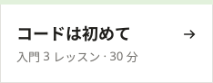
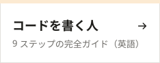
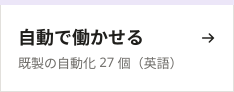
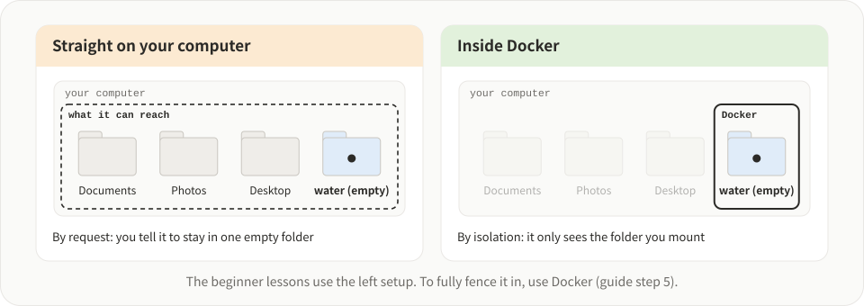

<div align="center">

# はじめての OpenHands

[English](./README.en.md) · [中文](./README.md) · **日本語** · [한국어](./README.ko.md) · [Español](./README.es.md) · [Português](./README.pt.md) · [Français](./README.fr.md) · [Deutsch](./README.de.md) · [Русский](./README.ru.md) · [العربية](./README.ar.md)

### AI に作業そのものを任せたいのに、公式ドキュメントで迷子になった？

[OpenHands](https://github.com/OpenHands/OpenHands) は、オープンソースの AI コーディングエージェントです。仕事を渡すと、コマンドを実行し、ファイルを書き換え、PR まで自分で出します。決まった時間に自分から作業を始めることもできます。<br>このガイドはやさしい言葉で説明するので、コードが書けなくてもついてこられます。

<a href="https://openhands.xiaoxiaodong.ai/ja/start/1-why/"><picture><source media="(prefers-color-scheme: dark)" srcset="assets/doors/ja-1-dark.svg"></picture></a> <a href="https://openhands.xiaoxiaodong.ai/en/guide/0-what/"><picture><source media="(prefers-color-scheme: dark)" srcset="assets/doors/ja-2-dark.svg"></picture></a> <a href="https://openhands.xiaoxiaodong.ai/en/automations/"><picture><source media="(prefers-color-scheme: dark)" srcset="assets/doors/ja-3-dark.svg"></picture></a>

<sub>無料 · オープンソース · 10 言語 · オンラインで読む：<a href="https://openhands.xiaoxiaodong.ai/ja/">openhands.xiaoxiaodong.ai/ja</a></sub>


</div>

<p align="center">
  
</p>

<p align="center">
  <a href="#-ここで止まっていませんか">つまずくところ</a> ·
  <a href="#-このガイドでできること">見どころ</a> ·
  <a href="#-どう動くか">どう動くか</a> ·
  <a href="#-3-ステップで使い始める">3 ステップ</a> ·
  <a href="#-自動で働かせる">自動化</a> ·
  <a href="#-実際のプロジェクトで">実際のプロジェクト</a> ·
  <a href="#-まず安全のこと">安全</a> ·
  <a href="#-ローカルで動かす">ローカルで動かす</a> ·
  <a href="https://openhands.xiaoxiaodong.ai/ja/">オンラインで読む</a>
</p>

## 😵 ここで止まっていませんか？

- 公式ドキュメントを開くと、npm、Docker、uv が並んでいて、どれを入れればいいのかわからない。
- Agent Canvas、Agent Server、バックエンド、ACP、Cloud、SDK。名前が多すぎて、自分に関係あるのがどれなのかわからない。
- 勝手にファイルを書き換えたりコマンドを実行したりすると聞いて、パソコンのほかの部分まで壊されないか心配。
- いくらかかるのか、先に AI の会社のアカウントをいくつも作らないといけないのか、わからない。

あなたのせいではありません。公式ドキュメントはエンジニア向けで、言葉を知っている前提で書かれています。このガイドは、まず使えるようにして、言葉は出てきたところで 1 つずつ説明します。

## ✨ このガイドでできること

- **30 分でゼロから使えるまで：** 入門 3 レッスンで、道は 1 つだけ。ターミナルのいらないデスクトップアプリ、モデルは 1 つ、空のフォルダで最初の小さなウェブページを作ります。
- **どのステップにも「何が見えればいいか」：** 見えたら次へ。見えなければ、手を動かす 2 つのレッスンの最後に「うまくいかないとき」があります。
- **お金の話をはっきり：** OpenHands そのものは無料です。Anthropic、OpenAI、Google のキーをすでに持っているか、Claude Code や Codex のサブスクリプションにログインしているなら、それを使えば追加の支払いはありません。どちらもないときだけ OpenHands Cloud で 10 ドルをチャージします。それを使わない無料のモデルもあります。
- **安全を先に：** 最初は、新しく作った空のフォルダの中だけで作業させます。しっかり隔離したいときのために、Docker での動かし方もあります。
- **そのままコピーできる言葉：** どの仕事も 3 つの部分で頼みます。**ほしいもの · できあがりの姿 · 終わったら見せてほしいもの**。How-to にはどれも、そのまま貼り付けられるプロンプトがあります。
- **既製の自動化を、やさしい 1 文ずつ：** 公式の 27 個すべてに、何をしてくれるか、先に何をつなぐか、どうオンにするかを書いています。
- **カーソルを乗せると意味が出る：** 点線の下線がある言葉は、1 行の説明が出ます。クリックすると Wiki へ進みます。
- **10 言語：** ホームと入門コースは 10 言語です。完全ガイド、How-to、Wiki、よくある質問は英語と中国語です。
- **リリースと照らし合わせ済み：** コマンドとボタン名は、OpenHands v1.40.0 の README と公式ドキュメントで確かめています。

## 🧭 どう動くか

<p align="center">
  
</p>

**Agent Canvas** で仕事を渡します。ブラウザかデスクトップアプリで使う操作画面です。受け取るのは、実際に作業するバックエンドの **Agent Server** です。自分のパソコン、Docker、VM、OpenHands Cloud のどこでも動かせます。エージェントは、つないだモデルで考えます。組み込みの OpenHands エージェントのほか、Claude Code、Codex、Gemini CLI も使えます。そして **ワークスペース** でファイルを読み書きし、コマンドを実行し、PR を出します。くわしくは[完全ガイドのステップ 0（英語）](https://openhands.xiaoxiaodong.ai/en/guide/0-what/)へ。

## ⚡ 3 ステップで使い始める

**1. デスクトップアプリを入れる。** OpenHands の[最新リリース](https://github.com/OpenHands/OpenHands/releases/latest)のページで、**Assets** の下から自分のシステム用のファイルをダウンロードします（Mac、Windows、Linux）。デスクトップアプリには必要なものが入っているので、ターミナルはいりません。コードを書く方は npm でも入れられます。

```bash
npm install -g @openhands/agent-canvas
agent-canvas
```

**2. モデルをつなぐ。** すでに持っているものによって変わります。

| 持っているもの | つなぎ方 | 追加の費用は？ |
|:---|:---|:---|
| Anthropic、OpenAI、Google などのプロバイダーの API キー | モデルを設定するときにプロバイダーを選び、キーを貼り付ける | なし。そのプロバイダーの料金で請求されます |
| ログイン済みの Claude Code、Codex、Gemini CLI のサブスクリプション | ACP でつなぐ。[ステップ 4（英語）](https://openhands.xiaoxiaodong.ai/en/guide/4-agents/)を参照 | なし。すでに払っているサブスクリプションを使います |
| どちらもない | OpenHands Cloud でキーを手に入れる。[レッスン 2](https://openhands.xiaoxiaodong.ai/ja/start/2-install/)を参照 | 先に 10 ドルをチャージ。`Free` と書かれたモデルはそれを使いません |

**3. 空のフォルダで仕事を 1 つ渡す。** 新しい空のフォルダを作り、Agent Canvas で開いて、たとえばこう送ります。

```text
ほしいもの：毎日コップ何杯の水を飲んだかを記録する、小さなウェブページ。ここは空のフォルダです。ファイルはすべてこの中に作り、このフォルダの外には一切触れないでください。
できあがりの姿：ページを開いて「1 杯飲んだ」を押すと、今日の杯数が 1 つ増える。閉じてもう一度開いても数字が残っている。最近 7 日間、毎日何杯飲んだかがページに表示される。
終わったら見せてほしいもの：何を確かめたか、それぞれ何が見えたか。最後に、どのファイルをダブルクリックすればページが開くか教えてください。
```

> [!TIP]
> 何を頼むときも、同じ 3 つの部分で書きます。**ほしいもの · できあがりの姿 · 終わったら見せてほしいもの**。「できました」と言われたら、結果を開いて自分で確かめてください。くわしくは[レッスン 3](https://openhands.xiaoxiaodong.ai/ja/start/3-first-use/)へ。

## 🤖 自動で働かせる

<p align="center">
  
</p>

OpenHands は、決まった時間や、何かが起きたときに、自分から会話を始められます。これが**自動化**です。公式の既製の自動化が 27 個あり、選んでオンにするだけです。いくつか例を挙げます（リンク先は英語のページです）。

| 既製の自動化 | 動くタイミング | してくれること |
|:---|:---|:---|
| [GitHub のコードレビュー](https://openhands.xiaoxiaodong.ai/en/automations/github-pr-reviewer/) | スケジュール / イベント | レビュー待ちのプルリクエストを見つけ、エージェントに GitHub 上でレビューさせる |
| [Linear の issue から GitHub の PR へ](https://openhands.xiaoxiaodong.ai/en/automations/linear-issue-to-github-pr/) | スケジュール / イベント | Linear の issue を準備完了にすると、エージェントが実装して GitHub の PR を出す |
| [Slack のスタンドアップまとめ](https://openhands.xiaoxiaodong.ai/en/automations/slack-standup-digest/) | スケジュール | 平日の毎朝、前日の Slack のメッセージをスタンドアップのメモにまとめる |
| [毎日のニュースまとめ](https://openhands.xiaoxiaodong.ai/en/automations/news-digest/) | スケジュール | 毎日ニュースフィードを読み、あなたに大事なものを選んで短いまとめを書く |
| [AGENTS.md Maintainer](https://openhands.xiaoxiaodong.ai/en/automations/github-agents-md-maintainer/) | スケジュール | AGENTS.md を最新に保ち、変わったら PR を出す |

27 個すべては[既製の自動化（英語）](https://openhands.xiaoxiaodong.ai/en/automations/)にあります。自分で作るなら、[完全ガイドのステップ 6（英語）](https://openhands.xiaoxiaodong.ai/en/guide/6-automations/)を見てください。

## 🛠 実際のプロジェクトで

リンク先はどれも英語のページです。

| いまの仕事 | 読むページ | ポイント |
|:---|:---|:---|
| 知らないコードベース | [まず理解する](https://openhands.xiaoxiaodong.ai/en/howto/new-codebase/) | 何も変えずに読ませてプロジェクトを説明させ、それを AGENTS.md に残す |
| GitHub の issue | [PR にする](https://openhands.xiaoxiaodong.ai/en/howto/issue-to-pr/) | まず会話で 1 つやってみる。うまくいったら自動化をオンにして、あとはラベルを付けるだけ |
| PR のレビュー | [レビューさせる](https://openhands.xiaoxiaodong.ai/en/howto/code-review/) | PR で `/codereview` と打つ。すべての PR をレビューさせるなら自動化をオンに |
| 自分の変更に自信がない | [ユーザーのように試させる](https://openhands.xiaoxiaodong.ai/en/howto/qa-changes/) | `/qa-changes` と打つと、ソフトを動かして、証拠つきで報告してくれる |
| 触る範囲が広すぎて心配 | [Docker の中で動かす](https://openhands.xiaoxiaodong.ai/en/howto/docker-sandbox/) | Docker で起動すると、マウントした 1 つのフォルダしか見えない |
| コードを手元から出せない | [ローカルモデルを使う](https://openhands.xiaoxiaodong.ai/en/howto/local-llm/) | LM Studio でモデルを動かし、そのアドレスを Advanced の設定に入れる |
| 席を離れている | [スマホから見る](https://openhands.xiaoxiaodong.ai/en/howto/phone/) | スマホとパソコンを同じ Tailscale のネットワークに入れ、パソコンのアドレスを開く |
| 請求が心配 | [費用を抑える](https://openhands.xiaoxiaodong.ai/en/howto/cost/) | 小さなことには安いモデルを。自動化のスケジュールを詰めすぎない |

ほかにも[コピペできるプロンプト](https://openhands.xiaoxiaodong.ai/en/howto/recipes/)、[脇道にそれない頼み方](https://openhands.xiaoxiaodong.ai/en/howto/good-instructions/)、[開かない、つながらない？](https://openhands.xiaoxiaodong.ai/en/howto/troubleshoot/)など、全部で 19 ページあります。

## 🔒 まず安全のこと

<p align="center">
  
</p>

> [!WARNING]
> OpenHands をパソコンの上で直接動かすと、エージェントはあなたのアカウントの権限を持ちます。ファイルを読み書きし、コマンドを実行でき、初期設定では 1 ステップごとに確認を求めません。入門コースでは、新しく作った空のフォルダの中だけで作業させます。しっかり隔離したいなら、Docker で動かしてください（[完全ガイドのステップ 5（英語）](https://openhands.xiaoxiaodong.ai/en/guide/5-backends/)）。

## 📚 サイトの内容

- **[入門コース](https://openhands.xiaoxiaodong.ai/ja/start/1-why/)**：3 レッスン、30 分、コードは書かなくて大丈夫 · 何をしてくれるのか → インストールする → はじめて使う
- **[完全ガイド](https://openhands.xiaoxiaodong.ai/en/guide/0-what/)**（英語）：コードを書く人向けの 9 ステップ · OpenHands とは → インストール → モデル → 最初の会話 → ほかのエージェント → バックエンド → 自動化 → スキル、プラグイン、MCP → セルフホストと SDK
- **[既製の自動化](https://openhands.xiaoxiaodong.ai/en/automations/)**（英語）：27 個すべて。名前、グループ、トリガーで絞り込めます
- **[How-to](https://openhands.xiaoxiaodong.ai/en/howto/)**（英語）：19 ページ、1 ページに 1 つの仕事
- **[Wiki](https://openhands.xiaoxiaodong.ai/en/wiki/)**（英語）：29 の用語 · 一言で → たとえると → OpenHands では → よくある誤解
- **[よくある質問](https://openhands.xiaoxiaodong.ai/en/faq/)**（英語）：お金はかかる？ API キーは必要？ 確認なしでコマンドを実行するけど、安全？
- **言語**：ホームと入門コースは 10 言語。それ以外は英語と中国語

右上の <kbd>⌘</kbd> <kbd>K</kbd> でサイト全体を検索できます。ライト、ダーク、スマホのどれでも見られます。

## 💻 ローカルで動かす

```bash
npm install
npm run dev          # http://localhost:4421
npm run build        # dist/ に出力し、内部リンクをチェック
npm run check:i18n   # ほかの 8 言語がそろっているか
npm run assets       # README の画像を作り直す
npm run release      # ビルドして Cloudflare にデプロイ
```

```text
src/data/nav.js          サイト構造：入門コース、完全ガイド、How-to 一覧（唯一の情報源）
src/data/glossary.js     用語：カーソルを乗せたときの説明と Wiki の項目
src/data/automations.js  既製の自動化のデータ
src/i18n/                ほかの 8 言語の UI テキスト（base.js が英語の土台）
src/pages/start/         入門コース 3 レッスン（MDX）
src/pages/guide/         完全ガイド（MDX）
src/pages/howto/         How-to（MDX）
public/xxd/              Xiaoxiaodong UI Kit（同梱、CDN なし）
tools/build_assets.py    README のイラスト、入口カード、共有用画像
```

内容の編集、ページの追加、書き方のルールは [docs/MAINTAINING.md](docs/MAINTAINING.md)（中国語）にあります。

## 🙌 謝辞

- [OpenHands](https://github.com/OpenHands/OpenHands) は OpenHands のコントリビューターが作っています（MIT ライセンス）。これは非公式の入門ガイドです。コマンドと動作は[公式リポジトリ](https://github.com/OpenHands/OpenHands)と[公式ドキュメント](https://docs.openhands.dev)が正です。
- サイトの骨組みは [xxd-pstack](https://github.com/nevertoday/xxd-pstack) から借りています。画面は [Xiaoxiaodong UI Kit](https://ui.xiaoxiaodong.ai) を使っています。

わかりにくいところや、書いてあるとおりにやってもうまくいかないところがあれば、[issue を作成](https://github.com/nevertoday/xxd-openhands/issues)してください。

## 📄 ライセンス

ガイドの文章とサイトのコードは [MIT](LICENSE) です。`public/xxd/` にある Xiaoxiaodong UI Kit のビルドは対象外で、独自の [LICENSE](public/xxd/LICENSE) があります（非商用は無料、商用はライセンスが必要）。

Copyright (c) 2026 [Xiaoxiaodong](https://x.com/xiaoxiaodong)
