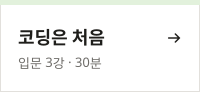
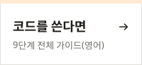
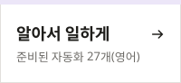
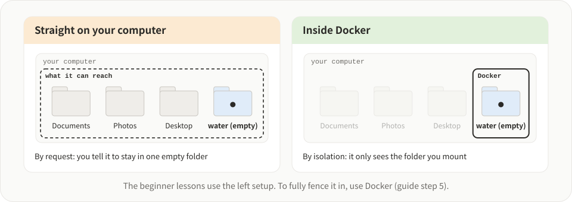

<div align="center">

# 처음 만나는 OpenHands

[English](./README.en.md) · [中文](./README.md) · [日本語](./README.ja.md) · **한국어** · [Español](./README.es.md) · [Português](./README.pt.md) · [Français](./README.fr.md) · [Deutsch](./README.de.md) · [Русский](./README.ru.md) · [العربية](./README.ar.md)

### 누가 OpenHands를 써 보라고 했는데, 공식 문서에서 길을 잃었나요?

[OpenHands](https://github.com/OpenHands/OpenHands)는 오픈소스 AI 코딩 에이전트예요. 일을 맡기면 명령어 실행, 파일 수정, PR 올리기까지 스스로 해요. 정해진 시간에 알아서 일을 시작할 수도 있어요.<br>이 가이드는 쉬운 말로 설명해서, 코딩을 몰라도 따라 할 수 있어요.

<a href="https://openhands.xiaoxiaodong.ai/ko/start/1-why/"><picture><source media="(prefers-color-scheme: dark)" srcset="assets/doors/ko-1-dark.svg"></picture></a> <a href="https://openhands.xiaoxiaodong.ai/en/guide/0-what/"><picture><source media="(prefers-color-scheme: dark)" srcset="assets/doors/ko-2-dark.svg"></picture></a> <a href="https://openhands.xiaoxiaodong.ai/en/automations/"><picture><source media="(prefers-color-scheme: dark)" srcset="assets/doors/ko-3-dark.svg"></picture></a>

<sub>무료 · 오픈소스 · 10개 언어 · 온라인으로 읽기: <a href="https://openhands.xiaoxiaodong.ai/ko/">openhands.xiaoxiaodong.ai/ko</a></sub>


</div>

<p align="center">
  
</p>

<p align="center">
  <a href="#-여기서-막혔나요">막혔나요?</a> ·
  <a href="#-이-가이드가-도와주는-것">이 가이드의 장점</a> ·
  <a href="#-어떻게-일하나요">작동 방식</a> ·
  <a href="#-세-단계로-시작하기">세 단계</a> ·
  <a href="#-알아서-일하게-하기">자동화</a> ·
  <a href="#-실제-프로젝트에서">실제 프로젝트</a> ·
  <a href="#-안전이-먼저">안전</a> ·
  <a href="#-로컬에서-실행하기">로컬 실행</a> ·
  <a href="https://openhands.xiaoxiaodong.ai/ko/">온라인으로 읽기</a>
</p>

## 😵 여기서 막혔나요?

- 공식 문서를 열었더니 npm, Docker, uv가 나와요. 뭘 설치해야 할지도 모르겠어요.
- Agent Canvas, Agent Server, 백엔드, ACP, Cloud, SDK. 이름은 많은데 나한테 맞는 게 뭔지 모르겠어요.
- 알아서 파일을 고치고 명령어를 실행한다는데, 컴퓨터의 다른 것까지 망가뜨릴까 봐 걱정돼요.
- 비용이 얼마나 드는지, 먼저 AI 회사 여러 곳에 가입해야 하는지도 모르겠어요.

당신 탓이 아니에요. 공식 문서는 엔지니어를 위해 쓰여 있어서, 용어를 이미 안다고 생각하고 설명해요. 이 가이드는 먼저 쓸 수 있게 해 주고, 용어는 나올 때마다 하나씩 설명해요.

## ✨ 이 가이드가 도와주는 것

- **30분 만에 처음부터 직접 써 보기까지:** 입문 레슨 3개, 길은 하나예요. 터미널이 필요 없는 데스크톱 앱, 모델 하나, 그리고 빈 폴더에서 만드는 첫 작은 웹페이지.
- **단계마다 뭐가 보여야 하는지 알려 줘요:** 보이면 다음으로 넘어가요. 안 보이면, 직접 해 보는 두 레슨 끝에 "뭔가 이상할 때"가 있어요.
- **돈 이야기를 솔직하게:** OpenHands 자체는 무료예요. Anthropic, OpenAI, Google 키가 이미 있거나 Claude Code나 Codex 구독에 로그인해 있다면, 그걸 쓰면 추가로 낼 돈이 없어요. 둘 다 없을 때만 OpenHands Cloud에 10달러를 충전하고, 그 돈을 쓰지 않는 무료 모델도 있어요.
- **안전이 먼저:** 처음에는 새로 만든 빈 폴더 안에서만 일하게 해요. 제대로 격리하고 싶다면 Docker로 실행하는 방법도 있어요.
- **그대로 복사해 쓰는 말:** 어떤 일이든 세 부분으로 맡겨요. **원하는 것 · 완성된 모습 · 끝나면 보여 줄 것**. How-to마다 그대로 붙여 넣을 수 있는 프롬프트가 있어요.
- **준비된 자동화를 쉬운 한 문장으로:** 공식 27개 전부에 대해, 무엇을 해 주는지, 먼저 무엇을 연결해야 하는지, 어떻게 켜는지 적었어요.
- **마우스를 올리면 뜻이 보여요:** 점선 밑줄이 있는 단어에는 한 줄 설명이 나오고, 누르면 Wiki로 가요.
- **10개 언어:** 홈과 입문 코스는 10개 언어로 있어요. 전체 가이드, How-to, Wiki, 자주 묻는 질문은 영어와 중국어로 있어요.
- **릴리스와 대조했어요:** 명령어와 버튼 이름은 OpenHands v1.40.0 README와 공식 문서로 확인했어요.

## 🧭 어떻게 일하나요

<p align="center">
  
</p>

**Agent Canvas**에서 일을 맡겨요. 브라우저나 데스크톱 앱에서 쓰는 관제 화면이에요. 그 일은 실제로 일하는 백엔드인 **Agent Server**가 받아요. 내 컴퓨터, Docker, VM, OpenHands Cloud 어디서든 돌릴 수 있어요. 에이전트는 연결한 모델로 생각해요. 기본 OpenHands 에이전트를 써도 되고, Claude Code, Codex, Gemini CLI를 써도 돼요. 그다음 **작업 공간**에서 파일을 읽고 쓰고, 명령어를 실행하고, PR을 올려요. 자세한 건 [전체 가이드 0단계(영어)](https://openhands.xiaoxiaodong.ai/en/guide/0-what/)에 있어요.

## ⚡ 세 단계로 시작하기

**1. 데스크톱 앱 설치하기.** OpenHands [최신 릴리스](https://github.com/OpenHands/OpenHands/releases/latest) 페이지의 **Assets**에서 내 시스템에 맞는 파일을 내려받으세요(Mac, Windows, Linux). 데스크톱 앱에 필요한 게 다 들어 있어서 터미널은 필요 없어요. 코딩하는 분이라면 npm으로도 설치할 수 있어요.

```bash
npm install -g @openhands/agent-canvas
agent-canvas
```

**2. 모델 연결하기.** 이미 가진 것에 따라 달라요.

| 가진 것 | 연결 방법 | 추가 비용? |
|:---|:---|:---|
| Anthropic, OpenAI, Google 같은 제공업체의 API 키 | 모델을 설정할 때 내 제공업체를 고르고, 키를 붙여 넣기 | 없어요. 그 제공업체 요금으로 청구돼요 |
| 로그인해 둔 Claude Code, Codex, Gemini CLI 구독 | ACP로 연결하기. [4단계(영어)](https://openhands.xiaoxiaodong.ai/en/guide/4-agents/) 참고 | 없어요. 이미 내고 있는 구독을 써요 |
| 둘 다 없음 | OpenHands Cloud에서 키 받기. [레슨 2](https://openhands.xiaoxiaodong.ai/ko/start/2-install/) 참고 | 먼저 10달러 충전. `Free` 표시가 있는 모델은 이 돈을 쓰지 않아요 |

**3. 빈 폴더에서 일 하나 맡기기.** 새 빈 폴더를 만들어 Agent Canvas에서 열고, 이렇게 보내 보세요.

```text
원하는 것: 매일 물을 몇 잔 마셨는지 기록하는 작은 웹페이지. 여기는 빈 폴더예요. 모든 파일을 이 폴더 안에 만들고, 이 폴더 밖의 것은 건드리지 마세요.
완성된 모습: 페이지를 열고 “한 잔 마셨어요”를 누르면 오늘 잔 수가 하나 늘어나요. 닫았다가 다시 열어도 숫자가 그대로 있어요. 페이지에서 최근 7일 동안 매일 몇 잔 마셨는지 볼 수 있어요.
끝나면 보여 줄 것: 무엇을 확인했는지, 그리고 확인할 때마다 뭐가 보였는지. 마지막으로 어떤 파일을 더블클릭하면 페이지가 열리는지 알려 주세요.
```

> [!TIP]
> 무엇을 맡기든 같은 세 부분을 쓰세요. **원하는 것 · 완성된 모습 · 끝나면 보여 줄 것**. 다 됐다고 하면 결과를 열어서 직접 확인하세요. 자세한 건 [레슨 3](https://openhands.xiaoxiaodong.ai/ko/start/3-first-use/)에 있어요.

## 🤖 알아서 일하게 하기

<p align="center">
  
</p>

OpenHands는 정해진 시간이나 어떤 일이 생겼을 때 스스로 대화를 시작할 수 있어요. 이걸 **자동화**라고 해요. 공식 준비된 자동화가 27개 있고, 하나 골라서 켜기만 하면 돼요. 몇 가지 예를 볼게요(링크는 영어 페이지예요).

| 준비된 자동화 | 실행 시점 | 해 주는 일 |
|:---|:---|:---|
| [GitHub 코드 리뷰](https://openhands.xiaoxiaodong.ai/en/automations/github-pr-reviewer/) | 예약 / 이벤트 | 리뷰를 기다리는 풀 리퀘스트를 찾아서, 에이전트가 GitHub에서 리뷰하게 해요 |
| [Linear 이슈를 GitHub PR로](https://openhands.xiaoxiaodong.ai/en/automations/linear-issue-to-github-pr/) | 예약 / 이벤트 | Linear 이슈를 준비됨으로 표시하면 에이전트가 구현하고 GitHub PR을 올려요 |
| [Slack 스탠드업 요약](https://openhands.xiaoxiaodong.ai/en/automations/slack-standup-digest/) | 예약 | 평일 아침마다 어제 Slack 메시지를 스탠드업 메모로 정리해요 |
| [매일 뉴스 요약](https://openhands.xiaoxiaodong.ai/en/automations/news-digest/) | 예약 | 매일 뉴스 피드를 읽고, 나에게 중요한 것을 골라 짧은 요약을 써요 |
| [AGENTS.md Maintainer](https://openhands.xiaoxiaodong.ai/en/automations/github-agents-md-maintainer/) | 예약 | AGENTS.md를 최신으로 유지하고, 바뀌면 PR을 올려요 |

27개 전부는 [준비된 자동화(영어)](https://openhands.xiaoxiaodong.ai/en/automations/)에 있어요. 직접 만들려면 [전체 가이드 6단계(영어)](https://openhands.xiaoxiaodong.ai/en/guide/6-automations/)를 보세요.

## 🛠 실제 프로젝트에서

링크는 모두 영어 페이지예요.

| 지금 할 일 | 읽을 페이지 | 요점 |
|:---|:---|:---|
| 처음 보는 코드베이스 | [먼저 이해하기](https://openhands.xiaoxiaodong.ai/en/howto/new-codebase/) | 아무것도 바꾸지 말고 읽게 해서 프로젝트를 설명하게 한 다음, 그 내용을 AGENTS.md에 저장해요 |
| GitHub 이슈 | [PR로 만들기](https://openhands.xiaoxiaodong.ai/en/howto/issue-to-pr/) | 먼저 대화에서 하나 해 보고, 잘 되면 자동화를 켜서 라벨만 붙이면 돼요 |
| PR 리뷰 | [리뷰 맡기기](https://openhands.xiaoxiaodong.ai/en/howto/code-review/) | PR에 `/codereview`를 입력해요. 모든 PR을 리뷰하게 하려면 자동화를 켜세요 |
| 내 변경이 미덥지 않을 때 | [사용자처럼 써 보게 하기](https://openhands.xiaoxiaodong.ai/en/howto/qa-changes/) | `/qa-changes`를 입력하면 소프트웨어를 실행해 보고, 증거와 함께 보고해요 |
| 너무 많이 건드릴까 걱정될 때 | [Docker 안에서 실행하기](https://openhands.xiaoxiaodong.ai/en/howto/docker-sandbox/) | Docker에서 시작하면 마운트한 폴더 하나만 보여요 |
| 코드가 내 컴퓨터 밖으로 나가면 안 될 때 | [로컬 모델 쓰기](https://openhands.xiaoxiaodong.ai/en/howto/local-llm/) | LM Studio로 모델을 띄우고, 그 주소를 Advanced 설정에 넣어요 |
| 자리를 비웠을 때 | [휴대폰으로 지켜보기](https://openhands.xiaoxiaodong.ai/en/howto/phone/) | 휴대폰과 컴퓨터를 같은 Tailscale 네트워크에 넣고, 컴퓨터 주소를 열어요 |
| 요금이 걱정될 때 | [비용 줄이기](https://openhands.xiaoxiaodong.ai/en/howto/cost/) | 작은 일에는 싼 모델을 쓰고, 자동화를 너무 자주 예약하지 마세요 |

그 밖에도 [복사해 쓰는 프롬프트](https://openhands.xiaoxiaodong.ai/en/howto/recipes/), [길을 잃지 않게 맡기는 법](https://openhands.xiaoxiaodong.ai/en/howto/good-instructions/), [열리지 않거나 연결이 안 될 때](https://openhands.xiaoxiaodong.ai/en/howto/troubleshoot/) 등 모두 19편이 있어요.

## 🔒 안전이 먼저

<p align="center">
  
</p>

> [!WARNING]
> OpenHands를 내 컴퓨터에서 바로 실행하면, 에이전트는 내 계정의 권한을 가져요. 파일을 읽고 쓰고 명령어를 실행할 수 있고, 기본 설정에서는 단계마다 묻지 않아요. 입문 코스에서는 새로 만든 빈 폴더 안에서만 일하게 해요. 제대로 격리하려면 Docker에서 실행하세요([전체 가이드 5단계(영어)](https://openhands.xiaoxiaodong.ai/en/guide/5-backends/)).

## 📚 사이트에 있는 것

- **[입문 코스](https://openhands.xiaoxiaodong.ai/ko/start/1-why/)**: 레슨 3개, 30분, 코딩을 몰라도 돼요 · 무엇을 해 주나요 → 설치하기 → 처음 써 보기
- **[전체 가이드](https://openhands.xiaoxiaodong.ai/en/guide/0-what/)**(영어): 코딩하는 분을 위한 9단계 · OpenHands란 → 설치 → 모델 → 첫 대화 → 다른 에이전트 → 백엔드 → 자동화 → 스킬, 플러그인, MCP → 셀프 호스팅과 SDK
- **[준비된 자동화](https://openhands.xiaoxiaodong.ai/en/automations/)**(영어): 27개 전부, 이름·그룹·트리거로 골라 보기
- **[How-to](https://openhands.xiaoxiaodong.ai/en/howto/)**(영어): 19편, 한 편에 일 하나
- **[Wiki](https://openhands.xiaoxiaodong.ai/en/wiki/)**(영어): 용어 24개 · 한 문장으로 → 비유하자면 → OpenHands에서는 → 흔한 오해
- **[자주 묻는 질문](https://openhands.xiaoxiaodong.ai/en/faq/)**(영어): 돈이 드나요? API 키가 필요한가요? 묻지도 않고 명령어를 실행하는데, 안전한가요?
- **언어**: 홈과 입문 코스는 10개 언어, 나머지는 영어와 중국어

오른쪽 위에서 <kbd>⌘</kbd> <kbd>K</kbd>를 누르면 사이트 전체를 검색할 수 있어요. 라이트, 다크, 휴대폰 화면 모두 잘 보여요.

## 💻 로컬에서 실행하기

```bash
npm install
npm run dev          # http://localhost:4421
npm run build        # dist/에 출력하고 내부 링크를 확인
npm run check:i18n   # 나머지 8개 언어가 다 갖춰졌는지 확인
npm run assets       # README 이미지 다시 만들기
npm run release      # 빌드하고 Cloudflare에 배포
```

```text
src/data/nav.js          사이트 구조: 입문 코스, 전체 가이드, How-to 목록(유일한 원본)
src/data/glossary.js     용어: 마우스를 올리면 나오는 설명과 Wiki 항목
src/data/automations.js  준비된 자동화 데이터
src/i18n/                나머지 8개 언어의 UI 문구(base.js가 영어 기준)
src/pages/start/         입문 코스 레슨 3개(MDX)
src/pages/guide/         전체 가이드(MDX)
src/pages/howto/         How-to(MDX)
public/xxd/              Xiaoxiaodong UI Kit(함께 포함, CDN 없음)
tools/build_assets.py    README 그림, 입구 카드, 공유 이미지
```

내용 수정, 페이지 추가, 글쓰기 규칙은 [docs/MAINTAINING.md](docs/MAINTAINING.md)(중국어)에 있어요.

## 🙌 감사의 말

- [OpenHands](https://github.com/OpenHands/OpenHands)는 OpenHands 기여자들이 만들었어요(MIT 라이선스). 이 가이드는 비공식 입문 가이드예요. 명령어와 동작은 [공식 저장소](https://github.com/OpenHands/OpenHands)와 [공식 문서](https://docs.openhands.dev)가 기준이에요.
- 사이트 뼈대는 [xxd-pstack](https://github.com/nevertoday/xxd-pstack)에서 가져왔고, 화면은 [Xiaoxiaodong UI Kit](https://ui.xiaoxiaodong.ai)를 써요.

설명이 헷갈리거나, 쓰인 대로 했는데 안 되는 곳이 있나요? [이슈를 열어 주세요](https://github.com/nevertoday/xxd-openhands/issues).

## 📄 라이선스

가이드 글과 사이트 코드는 [MIT](LICENSE)예요. `public/xxd/`의 Xiaoxiaodong UI Kit 빌드는 예외로, 별도의 [LICENSE](public/xxd/LICENSE)를 따라요(비상업적 사용은 무료, 상업적 사용은 라이선스 필요).

Copyright (c) 2026 [Xiaoxiaodong](https://x.com/xiaoxiaodong)
