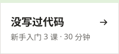
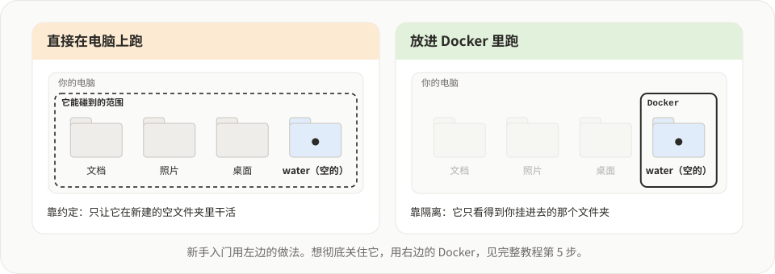

<div align="center">

# OpenHands 新手教程

[English](./README.en.md) · **中文** · [日本語](./README.ja.md) · [한국어](./README.ko.md) · [Español](./README.es.md) · [Português](./README.pt.md) · [Français](./README.fr.md) · [Deutsch](./README.de.md) · [Русский](./README.ru.md) · [العربية](./README.ar.md)

### 有人推荐你用 OpenHands，官方文档却看得一头雾水？

[OpenHands](https://github.com/OpenHands/OpenHands) 是一个开源的 AI 编程代理：你交代一件事，它自己敲命令、改文件、开 PR，还能按时间自己开工。<br>这份教程用大白话把它讲清楚，不会写代码也能跟着做。

<a href="https://openhands.xiaoxiaodong.ai/start/1-why/"><picture><source media="(prefers-color-scheme: dark)" srcset="assets/doors/zh-1-dark.svg"></picture></a> <a href="https://openhands.xiaoxiaodong.ai/guide/0-what/"><picture><source media="(prefers-color-scheme: dark)" srcset="assets/doors/zh-2-dark.svg"></picture></a> <a href="https://openhands.xiaoxiaodong.ai/automations/"><picture><source media="(prefers-color-scheme: dark)" srcset="assets/doors/zh-3-dark.svg"></picture></a>

<sub>免费 · 开源 · 10 种语言 · 在线阅读：<a href="https://openhands.xiaoxiaodong.ai">openhands.xiaoxiaodong.ai</a></sub>


</div>

<p align="center">
  
</p>

<p align="center">
  <a href="#-你是不是卡在这里">卡在哪</a> ·
  <a href="#-这份教程怎么帮你">亮点</a> ·
  <a href="#-它是怎么干活的">怎么干活</a> ·
  <a href="#-三步用上">三步用上</a> ·
  <a href="#-让它自己干活">自动化</a> ·
  <a href="#-在真实项目里">真实项目</a> ·
  <a href="#-先说安全">安全</a> ·
  <a href="#-本地运行">本地运行</a> ·
  <a href="https://openhands.xiaoxiaodong.ai">在线阅读</a>
</p>

## 😵 你是不是卡在这里

- 打开官方文档，满屏是 npm、Docker、uv，还没开始就不知道该装哪个。
- Agent Canvas、Agent Server、后端、ACP、Cloud、SDK，名字一大堆，分不清哪个是给你用的。
- 听说它会自己改文件、跑命令，又怕它把电脑上别的东西弄乱。
- 不知道要花多少钱，要不要先去各家开一堆账号。

不是你笨。官方文档是写给工程师的，默认你已经知道这些词。这份教程先带你用上，再慢慢讲清楚每个词。

## ✨ 这份教程怎么帮你

- **半小时从零到用上**：新手入门 3 课，一条路走到底：装桌面版，不用开终端；接一个模型；在空文件夹里做出第一个小网页。
- **每一步都写了「你应该看到什么」**：看到了就往下走；没看到，动手的两课末尾都有「不对怎么办」。
- **钱说清楚**：OpenHands 本身免费。已有 Anthropic、OpenAI、Google 的 key，或者登录了 Claude Code、Codex 的订阅，直接用，不另外花钱。都没有，才去 OpenHands Cloud 充 10 美元，还有一个不扣钱的免费模型。
- **安全说在前面**：第一次只让它在一个新建的空文件夹里干活；想关进隔离环境，有 Docker 的做法。
- **能照抄的话**：交代任务只用三部分：**我想要什么 · 做好是什么样子 · 做完给我看什么**。每篇 How-to 都有能直接复制的提示词。
- **现成自动化，一个一句人话**：官方 27 个现成自动化，每个写清楚它替你做什么、要先接好什么、怎么开起来。
- **生词悬停就有解释**：正文里带虚线的词，鼠标停上去就有一句话，点进去是 Wiki。
- **10 种语言**：首页和新手入门有 10 种语言；完整教程、How-to、Wiki、常见问题有中文和 English。
- **核对过版本**：命令和按钮名都对照过 OpenHands v1.40.0 的 README 和官方文档。

## 🧭 它是怎么干活的

<p align="center">
  
</p>

你在 **Agent Canvas**（浏览器里或桌面版的控制台）交代一件事。**Agent Server**（真正干活的后台）接下来，它可以跑在你的电脑、Docker、虚拟机或 OpenHands Cloud 上。代理用你接上的模型来想，可以是 OpenHands 自带的代理，也可以是 Claude Code、Codex、Gemini CLI。最后它在**工作区**里读写文件、跑命令、开 PR。详见 [完整教程第 0 步](https://openhands.xiaoxiaodong.ai/guide/0-what/)。

## ⚡ 三步用上

**1. 装桌面版。** 到 [OpenHands 最新版本](https://github.com/OpenHands/OpenHands/releases/latest) 的 **Assets** 里，下载你系统的文件（Mac、Windows、Linux 都有）。桌面版自带要用的东西，不用开终端。会写代码的也可以用 npm：

```bash
npm install -g @openhands/agent-canvas
agent-canvas
```

**2. 接一个模型。** 看你手上有什么：

| 你手上有 | 怎么接 | 要不要另外花钱 |
|:---|:---|:---|
| Anthropic、OpenAI、Google 等服务商的 API key | 设置模型时选你那家，贴上 key | 不用，照那家的价格扣 |
| 已登录的 Claude Code、Codex 或 Gemini CLI 订阅 | 通过 ACP 接进来，见 [第 4 步](https://openhands.xiaoxiaodong.ai/guide/4-agents/) | 不用，用你已经付过的订阅 |
| 什么都没有 | 在 OpenHands Cloud 拿一个 key，见 [第 2 课](https://openhands.xiaoxiaodong.ai/start/2-install/) | 先充 10 美元；选标着 `Free` 的模型不扣钱 |

**3. 在一个空文件夹里交代一件事。** 新建一个空文件夹，在 Agent Canvas 里打开它，发这样一段话：

```text
我想要：一个记录每天喝了几杯水的小网页。这是一个空文件夹，所有文件都建在这里面，不要动这个文件夹以外的东西。
做好是什么样子：我打开网页，点一下「喝了一杯」，今天的杯数加一；关掉再打开，数字还在；页面上能看到最近 7 天每天喝了几杯。
做完给我看：你做了哪些检查，每一项看到了什么结果。最后告诉我，双击哪个文件能打开这个网页。
```

> [!TIP]
> 以后交代任何事都用这三部分：**我想要什么 · 做好是什么样子 · 做完给我看什么**。它说做完了，自己打开看一遍。详见 [第 3 课](https://openhands.xiaoxiaodong.ai/start/3-first-use/)。

## 🤖 让它自己干活

<p align="center">
  
</p>

OpenHands 能按时间或事件自己开一个对话干活，叫**自动化**。官方有 27 个现成的，挑一个开起来就行。几个例子：

| 现成自动化 | 什么时候跑 | 它替你做什么 |
|:---|:---|:---|
| [GitHub code review](https://openhands.xiaoxiaodong.ai/automations/github-pr-reviewer/) | 定时 / 事件 | 找出等着审的 PR，审完把意见发到 GitHub |
| [Linear issue to GitHub PR](https://openhands.xiaoxiaodong.ai/automations/linear-issue-to-github-pr/) | 定时 / 事件 | Linear 里的 issue 标成可以开发，它就去实现，在 GitHub 开 PR |
| [Slack standup digest](https://openhands.xiaoxiaodong.ai/automations/slack-standup-digest/) | 定时 | 工作日早上，把昨天的 Slack 消息汇总成一份站会笔记 |
| [Daily news digest](https://openhands.xiaoxiaodong.ai/automations/news-digest/) | 定时 | 每天读一遍你订的新闻源，挑出你关心的，写成简报 |
| [AGENTS.md Maintainer](https://openhands.xiaoxiaodong.ai/automations/github-agents-md-maintainer/) | 定时 | 每周帮你更新 AGENTS.md，有变化就开 PR |

全部 27 个见 [现成自动化](https://openhands.xiaoxiaodong.ai/automations/)，自己写一个见 [完整教程第 6 步](https://openhands.xiaoxiaodong.ai/guide/6-automations/)。

## 🛠 在真实项目里

| 你手上的活 | 看这篇 | 一句话要点 |
|:---|:---|:---|
| 接手陌生项目 | [先看懂再动手](https://openhands.xiaoxiaodong.ai/howto/new-codebase/) | 先让它只看不改，把项目讲清楚，再写进 AGENTS.md |
| 一个 GitHub issue | [做成 PR](https://openhands.xiaoxiaodong.ai/howto/issue-to-pr/) | 先在对话里做一个；顺手了再开自动化，打个标签它就开工 |
| 审 PR | [让它帮你审](https://openhands.xiaoxiaodong.ai/howto/code-review/) | 打 `/codereview` 审一个；想每个都审，就开自动化 |
| 改完心里没底 | [像用户一样试一遍](https://openhands.xiaoxiaodong.ai/howto/qa-changes/) | 打 `/qa-changes`，它把程序真跑起来，带着证据回报 |
| 怕它乱动 | [关进 Docker 里](https://openhands.xiaoxiaodong.ai/howto/docker-sandbox/) | 用 Docker 启动，它只看得到你挂进去的那个文件夹 |
| 不想把代码发出去 | [用本地模型](https://openhands.xiaoxiaodong.ai/howto/local-llm/) | 用 LM Studio 跑本地模型，在 Advanced 设置里填它的地址 |
| 出门在外 | [在手机上看它干活](https://openhands.xiaoxiaodong.ai/howto/phone/) | 用 Tailscale 连起手机和电脑，手机浏览器打开电脑的地址 |
| 怕花超 | [控制花费](https://openhands.xiaoxiaodong.ai/howto/cost/) | 小事用便宜模型，定时任务别开太密 |

还有 [照抄就能用的提示词](https://openhands.xiaoxiaodong.ai/howto/recipes/)、[怎么交代它才不跑偏](https://openhands.xiaoxiaodong.ai/howto/good-instructions/)、[打不开、连不上怎么办](https://openhands.xiaoxiaodong.ai/howto/troubleshoot/) 等，一共 19 篇。

## 🔒 先说安全

<p align="center">
  
</p>

> [!WARNING]
> OpenHands 在你电脑上直接跑的时候，AI 能用你的账号权限读写文件、执行命令，默认不会每一步都先问你。新手入门只让它在一个新建的空文件夹里干活；想彻底隔离，就用 Docker（[完整教程第 5 步](https://openhands.xiaoxiaodong.ai/guide/5-backends/)）。

## 📚 站里有什么

- **[新手入门](https://openhands.xiaoxiaodong.ai/start/1-why/)**：3 课 30 分钟，不会写代码也能看懂 · 它能帮你什么 → 装上它 → 第一次用
- **[完整教程](https://openhands.xiaoxiaodong.ai/guide/0-what/)**：9 步，给会写代码的人 · 是什么 → 安装 → 接模型 → 第一个对话 → 换代理 → 换后端 → 自动化 → 技能、插件、MCP → 自托管和 SDK
- **[现成自动化](https://openhands.xiaoxiaodong.ai/automations/)**：27 个，按名字、分组、触发方式筛选
- **[How-to](https://openhands.xiaoxiaodong.ai/howto/)**：19 篇，一篇只讲一件事
- **[Wiki](https://openhands.xiaoxiaodong.ai/wiki/)**：29 个词 · 一句话 → 打个比方 → 在 OpenHands 里 → 常见误区
- **[常见问题](https://openhands.xiaoxiaodong.ai/faq/)**：要钱吗？一定要有 API key 吗？它不问我就执行命令，安全吗？
- **语言**：首页和新手入门有 10 种语言；其他栏目有中文和 English

页面右上角 <kbd>⌘</kbd> <kbd>K</kbd> 全站搜索，亮色暗色、手机都能看。

## 💻 本地运行

```bash
npm install
npm run dev          # http://localhost:4421
npm run build        # 输出到 dist/，顺带查站内链接
npm run check:i18n   # 另外 8 种语言的翻译齐不齐
npm run assets       # 重新生成 README 里的图
npm run release      # 构建并部署到 Cloudflare
```

```text
src/data/nav.js          站点结构：新手入门、完整教程、How-to 清单（唯一来源）
src/data/glossary.js     术语表：悬停解释和 Wiki 的对应
src/data/automations.js  现成自动化的数据
src/i18n/                另外 8 种语言的界面文字（base.js 是英文底稿）
src/pages/start/         新手入门三课（MDX）
src/pages/guide/         完整教程（MDX）
src/pages/howto/         How-to（MDX）
public/xxd/              小小东 UI Kit（自带一份，不走 CDN）
tools/build_assets.py    README 插画、门卡和分享大图
```

改内容、加页面、写作规矩见 [docs/MAINTAINING.md](docs/MAINTAINING.md)。

## 🙌 致谢

- [OpenHands](https://github.com/OpenHands/OpenHands) 由 OpenHands contributors 开发（MIT 许可）。本站是非官方的入门教程，命令和行为以 [官方仓库](https://github.com/OpenHands/OpenHands) 和 [官方文档](https://docs.openhands.dev) 为准。
- 站点骨架来自 [xxd-pstack](https://github.com/nevertoday/xxd-pstack)，界面用 [小小东 UI Kit](https://ui.xiaoxiaodong.ai)。

发现哪里没写清楚、照做不成功，欢迎 [提 Issue](https://github.com/nevertoday/xxd-openhands/issues)。

## 📄 License

教程文字和站点代码采用 [MIT](LICENSE)。`public/xxd/` 里的小小东 UI Kit 构建产物不在此列，适用它自己的 [LICENSE](public/xxd/LICENSE)（非商用免费，商用需授权）。

Copyright (c) 2026 [小小东 Xiaoxiaodong](https://x.com/xiaoxiaodong)
