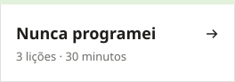
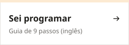
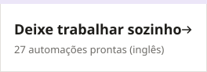

<div align="center">

# OpenHands para iniciantes

[English](./README.en.md) · [中文](./README.md) · [日本語](./README.ja.md) · [한국어](./README.ko.md) · [Español](./README.es.md) · **Português** · [Français](./README.fr.md) · [Deutsch](./README.de.md) · [Русский](./README.ru.md) · [العربية](./README.ar.md)

### Alguém recomendou o OpenHands e você se perdeu na documentação oficial?

O [OpenHands](https://github.com/OpenHands/OpenHands) é um agente de programação com IA, de código aberto. Você passa uma tarefa, e ele mesmo roda os comandos, edita os arquivos e abre o PR. Ele até pode começar a trabalhar sozinho num horário marcado.<br>Este guia explica tudo em palavras simples, para você conseguir acompanhar mesmo sem saber programar.

<a href="https://openhands.xiaoxiaodong.ai/pt/start/1-why/"><picture><source media="(prefers-color-scheme: dark)" srcset="assets/doors/pt-1-dark.svg"></picture></a> <a href="https://openhands.xiaoxiaodong.ai/en/guide/0-what/"><picture><source media="(prefers-color-scheme: dark)" srcset="assets/doors/pt-2-dark.svg"></picture></a> <a href="https://openhands.xiaoxiaodong.ai/en/automations/"><picture><source media="(prefers-color-scheme: dark)" srcset="assets/doors/pt-3-dark.svg"></picture></a>

<sub>Grátis · código aberto · 10 idiomas · Leia online: <a href="https://openhands.xiaoxiaodong.ai/pt/">openhands.xiaoxiaodong.ai/pt</a></sub>


</div>

<p align="center">
  
</p>

<p align="center">
  <a href="#-travou-aqui">Travou?</a> ·
  <a href="#-como-este-guia-ajuda">Destaques</a> ·
  <a href="#-como-funciona">Como funciona</a> ·
  <a href="#-funcionando-em-três-passos">Três passos</a> ·
  <a href="#-deixe-trabalhar-sozinho">Automações</a> ·
  <a href="#-em-projetos-reais">Projetos reais</a> ·
  <a href="#-segurança-em-primeiro-lugar">Segurança</a> ·
  <a href="#-rodar-localmente">Rodar localmente</a> ·
  <a href="https://openhands.xiaoxiaodong.ai/pt/">Ler online</a>
</p>

## 😵 Travou aqui?

- Você abre a documentação oficial e vê npm, Docker e uv antes de saber qual deles instalar.
- Agent Canvas, Agent Server, backends, ACP, Cloud, SDK: tantos nomes, e nenhuma pista de qual é para você.
- Você ouviu dizer que ele edita arquivos e roda comandos sozinho, e tem medo de que ele bagunce o resto do seu computador.
- Você não sabe quanto custa, nem se precisa antes abrir conta num monte de empresas de IA.

A culpa não é sua. A documentação oficial foi escrita para engenheiros e supõe que você já conhece os termos. Este guia primeiro coloca você para usar e depois explica cada termo quando ele aparece.

## ✨ Como este guia ajuda

- **Do zero ao funcionando em meia hora:** três lições para iniciantes, um só caminho: o aplicativo para computador, sem terminal, um modelo e a sua primeira pequena página web numa pasta vazia.
- **Cada passo diz o que você deve ver:** se apareceu, siga em frente. Se não, as duas lições práticas terminam com "Se algo der errado".
- **Dinheiro sem rodeios:** o OpenHands em si é gratuito. Se você já tem uma chave da Anthropic, OpenAI ou Google, ou está logado numa assinatura do Claude Code ou do Codex, use isso e não pague nada a mais. Só se não tiver nenhuma das duas você coloca US$ 10 no OpenHands Cloud, e existe um modelo gratuito que não gasta esse crédito.
- **Segurança desde o início:** na primeira vez, ele trabalha só dentro de uma pasta nova e vazia. Para um isolamento de verdade, existe uma configuração com Docker.
- **Frases para copiar:** toda tarefa tem três partes: **O que eu quero · Como fica quando estiver pronto · O que me mostrar ao terminar**. Cada how-to traz prompts para colar do jeito que estão.
- **Automações prontas, cada uma numa frase simples:** as 27 oficiais, cada uma com o que faz por você, o que conectar antes e como ligar.
- **Passe o mouse para ver a definição:** palavras com sublinhado pontilhado mostram uma explicação de uma linha; clique para ir à Wiki.
- **10 idiomas:** a página inicial e as lições para iniciantes estão em 10 idiomas; o guia completo, os how-to, a Wiki e as perguntas frequentes estão em inglês e em chinês.
- **Conferido com uma versão:** comandos e nomes de botões foram conferidos com o README do OpenHands v1.40.0 e com a documentação oficial.

## 🧭 Como funciona

<p align="center">
  
</p>

Você passa uma tarefa no **Agent Canvas**, a central de controle no seu navegador ou no aplicativo para computador. O **Agent Server**, o backend que faz o trabalho, assume a tarefa. Ele pode rodar no seu computador, no Docker, numa VM ou no OpenHands Cloud. O agente pensa com o modelo que você conectou; pode ser o agente OpenHands que já vem junto, ou Claude Code, Codex ou Gemini CLI. Depois ele lê e escreve arquivos, roda comandos e abre PRs no **espaço de trabalho**. Mais no [passo 0 do guia completo](https://openhands.xiaoxiaodong.ai/en/guide/0-what/) (em inglês).

## ⚡ Funcionando em três passos

**1. Instale o aplicativo para computador.** Na [versão mais recente do OpenHands](https://github.com/OpenHands/OpenHands/releases/latest), baixe o arquivo do seu sistema em **Assets** (Mac, Windows e Linux). O aplicativo já traz tudo de que precisa, então não tem terminal. Se você programa, o npm também funciona:

```bash
npm install -g @openhands/agent-canvas
agent-canvas
```

**2. Conecte um modelo.** Depende do que você já tem:

| Você tem | Como conectar | Custo a mais? |
|:---|:---|:---|
| Uma API key da Anthropic, OpenAI, Google ou outro provedor | Escolha o seu provedor ao configurar o modelo e cole a chave | Não, é cobrado pelos preços desse provedor |
| Uma assinatura do Claude Code, Codex ou Gemini CLI em que você está logado | Conecte via ACP; veja o [passo 4](https://openhands.xiaoxiaodong.ai/en/guide/4-agents/) (em inglês) | Não, usa a assinatura que você já paga |
| Nenhuma das duas | Pegue uma chave no OpenHands Cloud; veja a [lição 2](https://openhands.xiaoxiaodong.ai/pt/start/2-install/) | Coloque US$ 10 antes; os modelos marcados como `Free` não gastam esse crédito |

**3. Passe uma tarefa numa pasta vazia.** Crie uma pasta nova e vazia, abra no Agent Canvas e mande algo assim:

```text
O que eu quero: uma pequena página web que registre quantos copos de água eu bebo por dia. Esta pasta está vazia. Coloque todos os arquivos nela e não mexa em nada fora dela.
Como fica quando estiver pronto: eu abro a página e clico em "Bebi um copo", e o número de hoje aumenta em um; eu fecho e abro de novo, e o número continua lá; a página mostra quantos copos eu bebi em cada um dos últimos 7 dias.
Ao terminar, me mostre: o que você verificou e o que viu em cada verificação. Depois me diga em qual arquivo clicar duas vezes para abrir a página.
```

> [!TIP]
> Use as mesmas três partes para qualquer pedido: **O que eu quero · Como fica quando estiver pronto · O que me mostrar ao terminar**. Quando ele disser que terminou, abra o resultado e confira você mesmo. Mais na [lição 3](https://openhands.xiaoxiaodong.ai/pt/start/3-first-use/).

## 🤖 Deixe trabalhar sozinho

O OpenHands pode iniciar uma conversa sozinho, num horário marcado ou quando algo acontece. Isso são as **automações**. Há 27 automações oficiais prontas; escolha uma e ligue. Alguns exemplos (as páginas estão em inglês):

| Automação pronta | Quando roda | O que faz por você |
|:---|:---|:---|
| [Revisão de código no GitHub](https://openhands.xiaoxiaodong.ai/en/automations/github-pr-reviewer/) | Agendada / por evento | Encontra pull requests esperando revisão e coloca um agente para revisá-los no GitHub |
| [De issue do Linear a PR no GitHub](https://openhands.xiaoxiaodong.ai/en/automations/linear-issue-to-github-pr/) | Agendada / por evento | Marque uma issue do Linear como pronta e o agente implementa e depois abre um PR no GitHub |
| [Resumo de standup no Slack](https://openhands.xiaoxiaodong.ai/en/automations/slack-standup-digest/) | Agendada | Toda manhã de dia útil, transforma as mensagens de ontem no Slack numa nota de standup |
| [Resumo diário de notícias](https://openhands.xiaoxiaodong.ai/en/automations/news-digest/) | Agendada | Lê suas fontes de notícias todo dia, escolhe o que importa para você e escreve um resumo curto |
| [Mantenedor do AGENTS.md](https://openhands.xiaoxiaodong.ai/en/automations/github-agents-md-maintainer/) | Agendada | Mantém o AGENTS.md atualizado e abre um PR quando ele muda |

As 27 estão em [Automações prontas](https://openhands.xiaoxiaodong.ai/en/automations/) (em inglês). Para escrever as suas, veja o [passo 6 do guia completo](https://openhands.xiaoxiaodong.ai/en/guide/6-automations/) (em inglês).

## 🛠 Em projetos reais

Os how-to estão em inglês.

| O que você tem em mãos | Leia isto | Em resumo |
|:---|:---|:---|
| Um código que você não conhece | [Entenda primeiro](https://openhands.xiaoxiaodong.ai/en/howto/new-codebase/) | Peça para ele ler sem mudar nada, explicar o projeto e depois salvar isso no AGENTS.md |
| Uma issue do GitHub | [Transforme em PR](https://openhands.xiaoxiaodong.ai/en/howto/issue-to-pr/) | Faça uma numa conversa primeiro; quando funcionar, ligue a automação e só adicione uma label |
| Revisar PRs | [Deixe ele revisar](https://openhands.xiaoxiaodong.ai/en/howto/code-review/) | Digite `/codereview` num PR; para revisar todos os PRs, ligue a automação |
| Inseguro com as suas mudanças | [Teste como um usuário](https://openhands.xiaoxiaodong.ai/en/howto/qa-changes/) | Digite `/qa-changes`; ele roda o software e volta com provas |
| Medo de ele mexer em coisa demais | [Rode dentro do Docker](https://openhands.xiaoxiaodong.ai/en/howto/docker-sandbox/) | Inicie no Docker, e ele só enxerga a pasta que você montar |
| O código não pode sair da sua máquina | [Use um modelo local](https://openhands.xiaoxiaodong.ai/en/howto/local-llm/) | Sirva um modelo com o LM Studio e coloque o endereço dele nas configurações avançadas |
| Longe do computador | [Acompanhe pelo celular](https://openhands.xiaoxiaodong.ai/en/howto/phone/) | Coloque celular e computador na mesma rede Tailscale e abra o endereço do computador |
| Preocupado com a conta | [Gaste menos](https://openhands.xiaoxiaodong.ai/en/howto/cost/) | Modelos baratos para coisas pequenas; não agende automações com muita frequência |

E ainda [prompts para copiar e colar](https://openhands.xiaoxiaodong.ai/en/howto/recipes/), [como passar instruções para ele não se perder](https://openhands.xiaoxiaodong.ai/en/howto/good-instructions/), [não abre ou não conecta?](https://openhands.xiaoxiaodong.ai/en/howto/troubleshoot/) e mais: 19 ao todo.

## 🔒 Segurança em primeiro lugar

> [!WARNING]
> Quando o OpenHands roda direto no seu computador, o agente tem as permissões da sua conta: pode ler e escrever seus arquivos e rodar comandos, e por padrão não pergunta antes de cada passo. As lições para iniciantes fazem ele trabalhar só dentro de uma pasta nova e vazia. Para um isolamento de verdade, rode no Docker ([passo 5 do guia completo](https://openhands.xiaoxiaodong.ai/en/guide/5-backends/), em inglês).

## 📚 O que tem no site

- **[Para iniciantes](https://openhands.xiaoxiaodong.ai/pt/start/1-why/)**: 3 lições, 30 minutos, sem programar · O que ele faz por você → Instale → Use pela primeira vez
- **[Guia completo](https://openhands.xiaoxiaodong.ai/en/guide/0-what/)** (em inglês): 9 passos para quem programa · o que é → instalar → modelos → primeira conversa → outros agentes → backends → automações → skills, plugins e MCP → hospedagem própria e o SDK
- **[Automações prontas](https://openhands.xiaoxiaodong.ai/en/automations/)** (em inglês): as 27, com filtro por nome, grupo ou gatilho
- **[How-to](https://openhands.xiaoxiaodong.ai/en/howto/)** (em inglês): 19 páginas, uma tarefa em cada
- **[Wiki](https://openhands.xiaoxiaodong.ai/en/wiki/)** (em inglês): 24 termos · uma frase → uma analogia → no OpenHands → equívocos comuns
- **[Perguntas frequentes](https://openhands.xiaoxiaodong.ai/en/faq/)** (em inglês): Custa dinheiro? Preciso de uma API key? Ele roda comandos sem perguntar; isso é seguro?
- **Idiomas**: a página inicial e as lições para iniciantes em 10 idiomas; todo o resto em inglês e em chinês

Aperte <kbd>⌘</kbd> <kbd>K</kbd> no canto superior direito para buscar no site inteiro. Funciona no tema claro, no escuro e no celular.

## 💻 Rodar localmente

```bash
npm install
npm run dev          # http://localhost:4421
npm run build        # gera dist/ e verifica os links internos
npm run check:i18n   # os outros 8 idiomas estão completos?
npm run assets       # gera de novo as imagens do README
npm run release      # compila e publica na Cloudflare
```

```text
src/data/nav.js          estrutura do site: lições, guia completo, lista de how-to (fonte única)
src/data/glossary.js     termos: o texto ao passar o mouse e o verbete na Wiki
src/data/automations.js  dados das automações prontas
src/i18n/                textos da interface para os outros 8 idiomas (base.js é a base em inglês)
src/pages/start/         as 3 lições para iniciantes (MDX)
src/pages/guide/         o guia completo (MDX)
src/pages/howto/         os how-to (MDX)
public/xxd/              Xiaoxiaodong UI Kit (cópia incluída, sem CDN)
tools/build_assets.py    ilustrações do README, cartões de entrada e imagens de compartilhamento
```

Como editar conteúdo, adicionar páginas e as regras de escrita estão em [docs/MAINTAINING.md](docs/MAINTAINING.md) (em chinês).

## 🙌 Créditos

- O [OpenHands](https://github.com/OpenHands/OpenHands) é feito pelos colaboradores do OpenHands (licença MIT). Este é um guia não oficial para iniciantes; o [repositório oficial](https://github.com/OpenHands/OpenHands) e a [documentação](https://docs.openhands.dev) são a referência para comandos e comportamento.
- A estrutura do site vem do [xxd-pstack](https://github.com/nevertoday/xxd-pstack); a interface usa o [Xiaoxiaodong UI Kit](https://ui.xiaoxiaodong.ai).

Achou algo confuso, ou algo que não funcionou como está escrito? [Abra uma issue](https://github.com/nevertoday/xxd-openhands/issues).

## 📄 Licença

O texto do guia e o código do site estão sob [MIT](LICENSE). A build do Xiaoxiaodong UI Kit em `public/xxd/` não; ela tem a sua própria [LICENSE](public/xxd/LICENSE) (gratuita para uso não comercial; uso comercial exige licença).

Copyright (c) 2026 [Xiaoxiaodong](https://x.com/xiaoxiaodong01)
