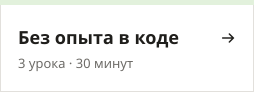
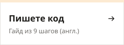
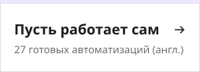

<div align="center">

# OpenHands для начинающих

[English](./README.en.md) · [中文](./README.md) · [日本語](./README.ja.md) · [한국어](./README.ko.md) · [Español](./README.es.md) · [Português](./README.pt.md) · [Français](./README.fr.md) · [Deutsch](./README.de.md) · **Русский** · [العربية](./README.ar.md)

### Вам посоветовали OpenHands, а в официальной документации вы запутались?

[OpenHands](https://github.com/OpenHands/OpenHands) — ИИ-агент для программирования с открытым кодом. Вы даёте ему задачу, а он сам выполняет команды, правит файлы и открывает PR. Он даже умеет браться за работу по расписанию.<br>Это руководство объясняет всё простыми словами, так что разобраться можно, даже если вы не пишете код.

<a href="https://openhands.xiaoxiaodong.ai/ru/start/1-why/"><picture><source media="(prefers-color-scheme: dark)" srcset="assets/doors/ru-1-dark.svg"></picture></a> <a href="https://openhands.xiaoxiaodong.ai/en/guide/0-what/"><picture><source media="(prefers-color-scheme: dark)" srcset="assets/doors/ru-2-dark.svg"></picture></a> <a href="https://openhands.xiaoxiaodong.ai/en/automations/"><picture><source media="(prefers-color-scheme: dark)" srcset="assets/doors/ru-3-dark.svg"></picture></a>

<sub>Бесплатно · открытый код · 10 языков · Читать онлайн: <a href="https://openhands.xiaoxiaodong.ai/ru/">openhands.xiaoxiaodong.ai/ru</a></sub>


</div>

<p align="center">
  
</p>

<p align="center">
  <a href="#-застряли-здесь">Застряли?</a> ·
  <a href="#-чем-поможет-это-руководство">Главное</a> ·
  <a href="#-как-это-работает">Как это работает</a> ·
  <a href="#-три-шага-чтобы-начать">Три шага</a> ·
  <a href="#-пусть-работает-сам">Автоматизации</a> ·
  <a href="#-в-реальных-проектах">Реальные проекты</a> ·
  <a href="#-сначала-безопасность">Безопасность</a> ·
  <a href="#-локальный-запуск">Локальный запуск</a> ·
  <a href="https://openhands.xiaoxiaodong.ai/ru/">Читать онлайн</a>
</p>

## 😵 Застряли здесь?

- Открываете официальную документацию и видите npm, Docker и uv, ещё не понимая, что из этого ставить.
- Agent Canvas, Agent Server, бэкенды, ACP, Cloud, SDK: столько названий, и непонятно, что из этого для вас.
- Вы слышали, что он сам правит файлы и выполняет команды, и боитесь, что он испортит что-нибудь на компьютере.
- Непонятно, сколько это стоит и не придётся ли сначала заводить аккаунты у кучи ИИ-компаний.

Вы тут ни при чём. Официальная документация написана для инженеров и считает, что все слова вам уже знакомы. Это руководство сначала помогает начать пользоваться OpenHands, а каждое новое слово объясняет там, где оно встречается.

## ✨ Чем поможет это руководство

- **С нуля до результата за полчаса:** три урока для начинающих и один путь: приложение для компьютера без терминала, одна модель и ваша первая маленькая веб-страница в пустой папке.
- **На каждом шаге сказано, что вы должны увидеть:** увидели — идите дальше. Если нет, оба практических урока заканчиваются разделом «Если что-то не так».
- **Честно о деньгах:** сам OpenHands бесплатный. Если у вас уже есть ключ Anthropic, OpenAI или Google или вы вошли в подписку Claude Code или Codex, пользуйтесь ими и ничего сверху не платите. Только если нет ни того, ни другого, вы вносите $10 на OpenHands Cloud, и там есть бесплатная модель, которая эти деньги не тратит.
- **Безопасность с самого начала:** в первый раз он работает только внутри новой пустой папки. Для настоящей изоляции есть вариант с Docker.
- **Слова, которые можно просто скопировать:** любая задача состоит из трёх частей: **Что я хочу · Как выглядит «готово» · Что показать, когда закончишь**. В каждом How-to есть промпты, которые можно вставлять как есть.
- **Готовые автоматизации, каждая одной простой фразой:** все 27 официальных. Для каждой сказано, что она для вас делает, что подключить заранее и как её включить.
- **Определение по наведению:** у слов с пунктирным подчёркиванием есть пояснение в одну строку, а по клику открывается Wiki.
- **10 языков:** главная страница и курс для начинающих есть на 10 языках; полное руководство, How-to, Wiki и частые вопросы — на английском и китайском.
- **Сверено с релизом:** команды и названия кнопок сверены с README OpenHands v1.40.0 и официальной документацией.

## 🧭 Как это работает

<p align="center">
  
</p>

Вы передаёте задачу в **Agent Canvas** — пульт управления в браузере или в приложении для компьютера. Её берёт **Agent Server**, бэкенд, который и делает работу. Он может работать на вашем компьютере, в Docker, на виртуальной машине или в OpenHands Cloud. Агент думает с помощью модели, которую вы подключили; это может быть встроенный агент OpenHands, а может быть Claude Code, Codex или Gemini CLI. Дальше он читает и пишет файлы, выполняет команды и открывает PR в **рабочей папке** (workspace). Подробнее — в [шаге 0 полного руководства](https://openhands.xiaoxiaodong.ai/en/guide/0-what/) (на английском).

## ⚡ Три шага, чтобы начать

**1. Установите приложение для компьютера.** На странице [последнего релиза OpenHands](https://github.com/OpenHands/OpenHands/releases/latest) скачайте в разделе **Assets** файл для своей системы (есть для Mac, Windows и Linux). Приложение приносит с собой всё нужное, так что терминал не понадобится. Если вы пишете код, подойдёт и npm:

```bash
npm install -g @openhands/agent-canvas
agent-canvas
```

**2. Подключите модель.** Как именно — зависит от того, что у вас уже есть:

| Что у вас есть | Как подключить | Платить сверху? |
|:---|:---|:---|
| API-ключ Anthropic, OpenAI, Google или другого провайдера | При настройке модели выберите своего провайдера и вставьте ключ | Нет, оплата по ценам этого провайдера |
| Подписка Claude Code, Codex или Gemini CLI, в которую вы вошли | Подключите её через ACP, см. [шаг 4](https://openhands.xiaoxiaodong.ai/en/guide/4-agents/) (на английском) | Нет, расходуется подписка, за которую вы и так платите |
| Ни того, ни другого | Получите ключ на OpenHands Cloud, см. [урок 2](https://openhands.xiaoxiaodong.ai/ru/start/2-install/) | Сначала внесите $10; модели с пометкой `Free` их не тратят |

**3. Дайте ему одну задачу в пустой папке.** Создайте новую пустую папку, откройте её в Agent Canvas и отправьте примерно такое сообщение:

```text
Что я хочу: маленькую веб-страницу, которая считает, сколько стаканов воды я выпиваю за день. Это пустая папка. Все файлы создавай в ней и ничего за её пределами не трогай.
Как выглядит «готово»: я открываю страницу, нажимаю «Ещё стакан», и счётчик за сегодня увеличивается на один; я закрываю страницу, открываю снова, а число на месте; на странице видно, сколько стаканов было выпито в каждый из последних 7 дней.
Когда закончишь, покажи мне: что ты проверил и что увидел при каждой проверке. Потом скажи, какой файл открыть двойным щелчком, чтобы увидеть страницу.
```

> [!TIP]
> Из тех же трёх частей стройте любую просьбу: **Что я хочу · Как выглядит «готово» · Что показать, когда закончишь**. Когда он скажет, что закончил, откройте результат и проверьте сами. Подробнее — в [уроке 3](https://openhands.xiaoxiaodong.ai/ru/start/3-first-use/).

## 🤖 Пусть работает сам

OpenHands умеет сам начинать диалог по расписанию или когда что-то происходит. Это называется **автоматизации**. Официальных готовых автоматизаций 27: выберите нужную и включите. Вот несколько примеров (страницы по ссылкам на английском):

| Готовая автоматизация | Когда запускается | Что делает для вас |
|:---|:---|:---|
| [Ревью кода на GitHub](https://openhands.xiaoxiaodong.ai/en/automations/github-pr-reviewer/) | По расписанию / по событию | Находит pull request'ы, которые ждут ревью, и поручает агенту проверить их на GitHub |
| [Из задачи Linear в PR на GitHub](https://openhands.xiaoxiaodong.ai/en/automations/linear-issue-to-github-pr/) | По расписанию / по событию | Отметьте задачу в Linear как готовую, и агент её реализует, а потом откроет PR на GitHub |
| [Сводка из Slack к стендапу](https://openhands.xiaoxiaodong.ai/en/automations/slack-standup-digest/) | По расписанию | Каждое утро по будням превращает вчерашние сообщения в Slack в заметку для стендапа |
| [Ежедневная сводка новостей](https://openhands.xiaoxiaodong.ai/en/automations/news-digest/) | По расписанию | Каждый день читает ваши новостные ленты, выбирает важное для вас и пишет короткую сводку |
| [AGENTS.md Maintainer](https://openhands.xiaoxiaodong.ai/en/automations/github-agents-md-maintainer/) | По расписанию | Следит, чтобы AGENTS.md был актуальным, и открывает PR, когда что-то меняется |

Все 27 собраны в разделе [Готовые автоматизации](https://openhands.xiaoxiaodong.ai/en/automations/). Как написать свою — в [шаге 6 полного руководства](https://openhands.xiaoxiaodong.ai/en/guide/6-automations/).

## 🛠 В реальных проектах

Все страницы ниже на английском.

| Ваша задача | Что прочитать | Суть |
|:---|:---|:---|
| Незнакомая кодовая база | [Сначала разобраться](https://openhands.xiaoxiaodong.ai/en/howto/new-codebase/) | Пусть прочитает код, ничего не меняя, объяснит проект, а потом сохранит это в AGENTS.md |
| Issue на GitHub | [Превратить в PR](https://openhands.xiaoxiaodong.ai/en/howto/issue-to-pr/) | Сначала сделайте одну в диалоге; когда получится, включите автоматизацию и просто ставьте метку |
| Ревью PR | [Поручить ревью](https://openhands.xiaoxiaodong.ai/en/howto/code-review/) | Напишите `/codereview` в PR; чтобы проверять каждый PR, включите автоматизацию |
| Не уверены в своих изменениях | [Опробовать их как пользователь](https://openhands.xiaoxiaodong.ai/en/howto/qa-changes/) | Напишите `/qa-changes`: он запустит программу и отчитается с доказательствами |
| Боитесь, что он заденет лишнее | [Запустить в Docker](https://openhands.xiaoxiaodong.ai/en/howto/docker-sandbox/) | Запустите его в Docker, и он увидит только ту папку, которую вы подключите |
| Код не должен покидать ваш компьютер | [Локальная модель](https://openhands.xiaoxiaodong.ai/en/howto/local-llm/) | Запустите модель в LM Studio и впишите её адрес в настройках Advanced |
| Вы не за компьютером | [Следить с телефона](https://openhands.xiaoxiaodong.ai/en/howto/phone/) | Подключите телефон и компьютер к одной сети Tailscale и откройте адрес компьютера |
| Беспокоит счёт | [Снизить расходы](https://openhands.xiaoxiaodong.ai/en/howto/cost/) | Дешёвые модели для мелочей; не запускайте автоматизации по расписанию слишком часто |

А ещё [готовые промпты для копирования](https://openhands.xiaoxiaodong.ai/en/howto/recipes/), [как поставить задачу, чтобы он не сбивался с пути](https://openhands.xiaoxiaodong.ai/en/howto/good-instructions/), [не открывается или не подключается?](https://openhands.xiaoxiaodong.ai/en/howto/troubleshoot/) и другие, всего 19.

## 🔒 Сначала безопасность

> [!WARNING]
> Когда OpenHands работает прямо на вашем компьютере, у агента права вашей учётной записи: он может читать и писать ваши файлы и выполнять команды, а по умолчанию не спрашивает разрешения перед каждым шагом. В курсе для начинающих он работает только внутри новой пустой папки. Для настоящей изоляции запускайте его в Docker ([шаг 5 полного руководства](https://openhands.xiaoxiaodong.ai/en/guide/5-backends/), на английском).

## 📚 Что есть на сайте

Всё, кроме курса для начинающих, на английском.

- **[Курс для начинающих](https://openhands.xiaoxiaodong.ai/ru/start/1-why/)**: 3 урока, 30 минут, код писать не нужно · Чем он вам поможет → Установите его → Первый запуск
- **[Полное руководство](https://openhands.xiaoxiaodong.ai/en/guide/0-what/)**: 9 шагов для тех, кто пишет код · что это такое → установка → модели → первый диалог → другие агенты → бэкенды → автоматизации → навыки, плагины, MCP → свой сервер и SDK
- **[Готовые автоматизации](https://openhands.xiaoxiaodong.ai/en/automations/)**: все 27, с фильтром по названию, группе или триггеру
- **[How-to](https://openhands.xiaoxiaodong.ai/en/howto/)**: 19 страниц, на каждой одна задача
- **[Wiki](https://openhands.xiaoxiaodong.ai/en/wiki/)**: 24 термина · одна фраза → аналогия → как это устроено в OpenHands → частые заблуждения
- **[Частые вопросы](https://openhands.xiaoxiaodong.ai/en/faq/)**: Это стоит денег? Нужен ли API-ключ? Он выполняет команды без спроса — это безопасно?
- **Языки**: главная страница и курс для начинающих на 10 языках, всё остальное на английском и китайском

Нажмите <kbd>⌘</kbd> <kbd>K</kbd> в правом верхнем углу, чтобы искать по всему сайту. Сайт работает в светлой и тёмной теме и на телефоне.

## 💻 Локальный запуск

```bash
npm install
npm run dev          # http://localhost:4421
npm run build        # сборка в dist/ и проверка внутренних ссылок
npm run check:i18n   # все ли 8 других языков заполнены?
npm run assets       # пересобрать картинки для README
npm run release      # собрать и задеплоить на Cloudflare
```

```text
src/data/nav.js          структура сайта: курс для начинающих, полное руководство, список How-to (единый источник)
src/data/glossary.js     термины: подсказки при наведении и их статьи в Wiki
src/data/automations.js  данные готовых автоматизаций
src/i18n/                тексты интерфейса для остальных 8 языков (base.js — английская основа)
src/pages/start/         3 урока для начинающих (MDX)
src/pages/guide/         полное руководство (MDX)
src/pages/howto/         How-to (MDX)
public/xxd/              Xiaoxiaodong UI Kit (своя копия, без CDN)
tools/build_assets.py    иллюстрации для README, карточки-«двери» и картинки для соцсетей
```

Как править контент, добавлять страницы и правила написания — в [docs/MAINTAINING.md](docs/MAINTAINING.md) (на китайском).

## 🙌 Благодарности

- [OpenHands](https://github.com/OpenHands/OpenHands) создают участники проекта OpenHands (лицензия MIT). Это неофициальное руководство для начинающих; в вопросах команд и поведения источник истины — [официальный репозиторий](https://github.com/OpenHands/OpenHands) и [документация](https://docs.openhands.dev).
- Каркас сайта взят из [xxd-pstack](https://github.com/nevertoday/xxd-pstack), интерфейс сделан на [Xiaoxiaodong UI Kit](https://ui.xiaoxiaodong.ai).

Нашли что-то непонятное или что-то сработало не так, как написано? [Создайте issue](https://github.com/nevertoday/xxd-openhands/issues).

## 📄 Лицензия

Текст руководства и код сайта распространяются по лицензии [MIT](LICENSE). Сборка Xiaoxiaodong UI Kit в `public/xxd/` под неё не подпадает: у неё своя [LICENSE](public/xxd/LICENSE) (бесплатно для некоммерческого использования, для коммерческого нужна лицензия).

Copyright (c) 2026 [Xiaoxiaodong](https://x.com/xiaoxiaodong01)
